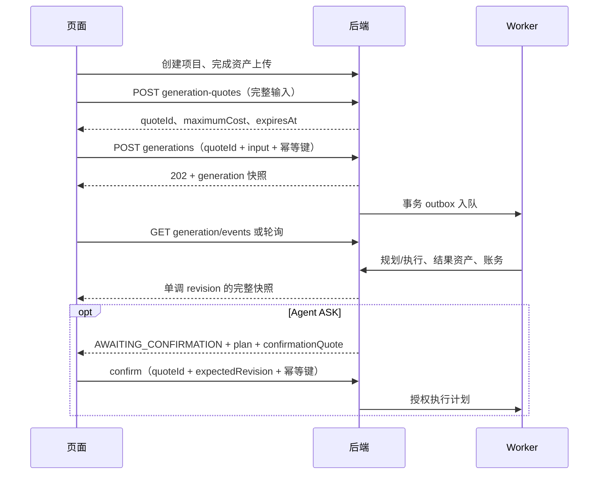

# RHTV 首页自建后端协议 v1.0.0

冻结日期：2026-10-03。服务入口：`/api/v1`。这是复刻项目的自建协议，不是 RunningHub 官方接口文档。

## 当前状态与交付文件

冻结协议制定时，真实后端接口为 **0**。当时页面保留原前端的请求位置，`dist/replica.js` 以拦截器、缓存和模拟应答支撑预览：审计了 70 个关联旧路径，其中 11 个路径有数据快照、共 14 个缓存变体。缓存不是后端实现，也不能证明原站完整请求/响应协议。

本目录已经确定首页相关业务的 **61 个资源路径、71 个操作**。登录、项目、上传、报价、生成、内容互动、通知、会员和支付订单均有请求/响应定义。服务实现时以以下文件联合为准：

| 文件 | 用途 |
| --- | --- |
| [openapi.json](openapi.json) / [openapi.yaml](openapi.yaml) | 等价的 OpenAPI 3.1.1，定义路径、字段、类型、鉴权和状态码，可导入接口工具或生成服务端骨架 |
| 本 README | 跨接口业务规则、事务边界、重试与验收标准 |
| [examples.json](examples.json) | 可验证的有效请求/响应及应被拒绝的输入 |
| [legacy-mapping.json](legacy-mapping.json) / [LEGACY-MAPPING.md](LEGACY-MAPPING.md) | 70 条旧调用到新协议的映射及明确延期项，供兼容层实施 |
| [legacy-inventory.json](legacy-inventory.json) | 旧前端的审计证据、缓存覆盖和未核实字段，保留证据与推断的区别 |
| [validate_contract.py](validate_contract.py) | 检查规范、引用、示例、映射和关键约束 |

**现行工程已迁移到 Go 最小服务和真实前端适配层。** 当前实现清单与内部版本开关见 [最小 API](../docs/api-minimal.md)，统一飞书认证扩展见 [auth-extension.json](auth-extension.json)。冻结的 v1 仍定义未来功能；密码/Google 登录、社区和支付等合同不意味着这些能力当前已上线。服务模式没有模拟身份或未知接口成功兜底。

**公司内部版的现行增量协议：** [assistant-extension](assistant-extension.json) 实现私有会话及USER文本消息；[library-extension](library-extension.json) 实现私有角色/场景库分页与管理；[model-product-extension](model-product-extension.json) 区分产品需要的模型能力和Router真实可用能力。均位于 `/api/v2`，使用IPAC稳定身份与工具级 `tv.access`，不接收工作空间。下文旧 v1 的报价、余额和支付流程仅是冻结历史设计，内部版强制禁用这些端点，生成路径不应依赖报价或余额。具体状态见各扩展的 IMPLEMENTED/RESERVED 以及[内部版说明](../docs/internal-edition.md)。

个人厂商 Key 使用独立的 [provider-credentials-extension](provider-credentials-extension.yaml)（IMPLEMENTED），提供用户本人配置、脱敏状态和删除。凭据不进入画布、模型参数或冻结的核心协议，使用规则见[个人厂商 Key 接入](../docs/personal-provider-keys.md)。

## 资源与操作

表中省略 `/api/v1`。准确字段、必填项及 operationId 见 OpenAPI。

| 模块 | 主要接口 | 行为 |
| --- | --- | --- |
| 身份 | `POST /auth/challenges`、`POST /auth/sessions`、Google authorization/exchange、refresh、`DELETE /auth/session` | 邮箱密码/验证码、Google、刷新和退出；真实身份由服务端签发 |
| 用户 | `GET /me`、`PATCH /me/preferences` | 用户、语言、默认模型、生成偏好 |
| 首页与模型 | `GET /home`、`GET /models`、`GET /model-groups` | 活动、开关、导航、上传限制、模型和版本化参数能力 |
| 项目 | `GET/POST /projects`、`GET/PATCH/DELETE /projects/{id}`、snapshot、pin、share-links、project-shares | 新建、重命名、删除、置顶、完整快照保存、受控分享和克隆 |
| 资产 | `GET /assets`、`POST /asset-uploads`、renew、complete、`GET/DELETE /assets/{id}` | 申请上传、校验完成、处理状态、资产库和临时访问地址 |
| 创作 | generation-quotes、generations、confirm、quote、cancel、events | 参数校验、报价、提交、计划确认、重报价、轮询、SSE、取消和结果 |
| 内容 | categories、compositions、skills、templates、workflows及详情 | 四类浏览、搜索、筛选、分页；技能子选项和版本化工作流 |
| 互动 | like、collection、favorite、share-link、playback-events | 持久点赞/收藏、分享及播放统计 |
| 通知 | `GET /notifications`、unread-count、`POST /notifications/read` | 更新记录、官方消息、任务通知与批量已读 |
| 会员与支付 | catalog/products、membership、wallet、wallet/entries、orders、checkout、billing/webhooks | 产品目录、权益、余额、流水、订单和签名支付回调 |
| 页面事件 | `POST /telemetry/events` | 明确允许的少量事件，禁止收集提示词、密码或令牌 |

首页点“开始创作”先创建项目，再上传输入、报价和提交任务。`POST /projects` 不生成、不收费；不能将原 `/canvas/create {}` 当作生成接口。

## 通用协议

### 请求、响应与类型

- JSON 使用 UTF-8；除快照上限 10 MiB 外，业务请求上限 1 MiB，超限 HTTP 413。文件由对象存储 PUT 上传，不经过 JSON 接口。
- 私有接口携带 `Authorization: Bearer <accessToken>`。个人空间省略 `X-Team-Id`；团队空间带该头，服务端验证成员关系及操作权限。资源 ID 不能绕过归属校验。
- 所有 ID 均为不透明字符串，包括用户、团队、模型、资产、报价、任务、订单、事件。大整数不能经 JSON number 传递。未知字段默认拒绝；允许自由键的模型参数也须通过对应 `parameterSchema`。
- 时间是 UTC RFC 3339，以 `Z` 结尾；时长明确使用秒，文件大小使用字节。`null` 代表明确无值；请求中省略可选字段代表不修改/使用默认。空数组代表主动清空对应集合。
- 金额为 `{ "currency": "USD", "amount": "0.242000" }`：非负十进制字符串，最多 6 位小数；禁止 float。服务器以十进制定点数计算，单项消耗按 6 位精度向上舍入后汇总，零不进位；不可因累计误差超过授权额度。支付最小单位换算按产品 `settlementScale`，不满足该币种精度的自定义充值返回 422。会员、余额和生成费率不强行用“分”表示。
- 成功为 `{ "code": 0, "message": "OK", "requestId": "req_…", "data": … }`；错误为独立 Error，不带成功 data。所有响应都含 `X-Request-Id`，必须与 body.requestId 一致。
- 创建资源一般 HTTP 201；异步操作 HTTP 202；其他成功 HTTP 200。异步资源响应给稳定 ID、状态和对应可轮询地址的 `Location`；telemetry/playback 是只接收事件的 202，没有轮询资源。重试返回首次接受的响应，之后通过 GET 取当前状态。
- 已知能力未上线返回 501 `NOT_IMPLEMENTED`；未知路径返回 404 `NOT_FOUND`。禁止 `success({})` 或 HTTP 200 包装所有失败。

### 分页与筛选

统一 `page`（默认 1）、`pageSize`（默认 20，范围 1–100），返回 `items/page/pageSize/total/hasMore`。空数据和超出末页均为成功空 items；总数为应用所有筛选后的数量。排序必须增加 ID 作为固定次序的第二键；项目置顶优先，然后应用 `sort`。

采用与原页面兼容的页码分页，不承诺并发新增/删除下跨页结果不移动；客户端按字符串 ID 去重，刷新从第 1 页重新加载。不得只筛选已经返回的第一页来伪造收藏、标签或团队分页。skills 的 `scope=OWNED/COLLECTED`、workflows 的 `favoritesOnly=true` 必须登录；templates 的 `tagId` 由数据库筛选。详情不存在返回 404，不返回 null 成功。

### 身份、刷新与公开读取

accessToken 有效期 900 秒；验证签名、固定允许算法、issuer、audience、exp，拒绝 `alg:none`。浏览器仅在内存保存 accessToken。刷新令牌使用 `__Host-rhtv_refresh` cookie：`HttpOnly; Secure; SameSite=Lax; Path=/`，最长 30 天，每次刷新轮换；重复使用被轮换的 token 撤销该令牌族。退出撤销刷新族，并使该会话已签发 accessToken 在剩余有效期内不能继续访问。

刷新和退出通过 cookie 认证，必须使用 `/auth/csrf` 返回的会话/预登录上下文绑定 token，携带 `X-CSRF-Token`；服务器校验 Origin 和允许来源。无上下文时该接口可建立短期预登录上下文，登录成功后重新签发 CSRF token。开发仅在明确配置的回环环境允许对应非 Secure 测试 cookie；生产固定上述属性。

验证码有效期 5 分钟、60 秒后可重发、最多 5 次尝试、单次消费，按地址/IP 限流。账号不存在时不泄漏身份信息。密码由 HTTPS 发送，后端采用现代密码哈希；原页面的 MD5 登录必须迁移，不能把 MD5 字符串当新密码保存。

Google 流程：浏览器生成 codeVerifier 和 S256 challenge → `authorization` 在服务端建立 10 分钟单次事务、产生 state、绑定 HttpOnly 浏览器事务 cookie、挑战与允许的 redirectUri → 跳转 → `exchange` 核验该事务并兑换。state、授权码与事务单次消费，失败不得复用。供应商 client secret 仅保留在后端。

标记可选 Bearer 的公开接口允许匿名；携带有效身份时返回该用户的 liked/collected、模型可用性等。**提交无效 Bearer 必须 401，不能静默降为匿名。匿名附带 X-Team-Id 也必须 401。** 跨团队的私有资源返回 404，避免通过错误差异枚举他人数据；当前空间权限不足而资源已可见时返回 403。

### 幂等、并发与重试

OpenAPI 指定 `Idempotency-Key` 的操作必须提供 UUID。作用域为已认证用户 + 团队/个人空间 + operationId + 路径资源 ID；请求指纹包含规范化 body 和有业务意义的头（如 If-Match），不包含 accessToken/requestId。必须在任何副作用之前、在版本冲突校验之前检查幂等记录。

相同键和相同请求重放首次已接受结果；相同键不同请求 409 `IDEMPOTENCY_CONFLICT`。并发第二个请求尚未有首次结果时 409 `REQUEST_IN_PROGRESS` + Retry-After，使用同一键重试。接受结果及资源创建、额度预留、出队事件写入同一数据库事务；用 outbox 投递 worker。未接受的参数错误不占用成功结果。任务和订单幂等记录至少保留到资源留存结束，删除资源后仍保留去重墓碑；其他操作最少 24 小时，不能在有效重试窗口内重新执行。

PUT/DELETE 点赞、收藏、置顶表达目标状态，天然幂等，不使用“翻转”。播放统计和页面事件由 eventId 在 24 小时内去重。

项目重命名/封面修改、删除、完整快照保存及分享指定版本必须携带强 ETag `If-Match: "3"`，GET 返回 ETag。置顶 PUT/DELETE 为原子幂等目标状态，不要求 If-Match；所有项目元数据、置顶、画布更新共享单调递增 revision；过期修改返回 412 `VERSION_CONFLICT`。生成确认/重报价的 expectedRevision 冲突同样 412，先读取最新快照再由用户确认。保存图只保存数据，不执行图中任务。

网络错误、429 或可重试 503 可采用带随机抖动的指数退避（1、2、4、8 秒，单次上限 30 秒），遵守 Retry-After。带副作用重试沿用原键。401 只尝试一次会话刷新，失败转登录；403/404/409/412/422 不盲目循环重试。限流阈值是部署配置，响应及恢复语义已固定。

## 上传与模型能力

1. 创建项目；计算文件 SHA-256。`POST /asset-uploads` 提交 projectId、fileName、mimeType、byteSize、checksumSha256。
2. 返回 uploadId、assetId、精确 PUT URL、必要 headers、15 分钟 expiresAt 和 24 小时 completeDeadlineAt。存储上传不得携带业务 Bearer。过期可 renew；必须仍在完成窗口内，续签不创建第二个 asset。
3. PUT 成功后 complete 提交 ETag。服务端查询真实对象并校验大小、校验和、媒体 MIME/元数据及访问归属；ETag 不能替代 SHA-256。返回 202 PROCESSING，轮询 asset 直到 READY 或 REJECTED。
4. 未完成/未 READY/已删除/校验失败的资产不能生成。只能引用本服务 assetId；浏览器 blob URL 或任意远程 URL 都不能作为执行输入。生成在提交时固定校验和和资产版本，活跃任务引用阻止删除，返回 409 `ASSET_IN_USE`。
5. 上传实际限制取 `/home.uploadLimits`、模型 inputs 与 512 MiB 协议硬上限的最小值；后端验证实际内容，不能只信文件后缀。访问 URL 是短期签名，资产 ID 永久作为引用；过期重新 GET 资产。资产达到完成窗口仍未上传则失效并清理对象，不自动成为 READY。

模型目录中的 `parameterSchema` 固定 JSON Schema 2020-12；必须明确类型、单位、枚举、nullable、默认值及参数组合联动，如 draft/resolution。直接模式必须提供 modelId、capabilityVersion 和 invocationType；invocationType 必须属于该模型目录，原页面 directSubType 必须保留为这个字段；outputCount 是最终目标结果数，不从隐藏 generateNum 读取。报价与提交都在后端验证 capabilityVersion、权限、输入 role/数量/时长及完整 params；不能接受供应商 apiUrl 或浏览器传来的完整模型对象作为执行权限。模型下架/版本变化返回 `MODEL_UNAVAILABLE` / `CAPABILITY_VERSION_CHANGED`，提示重新选择或报价。

MOTION_TRANSFER 还须由可用模型能力要求至少一张参考图和一个参考视频；角色使用 REFERENCE_IMAGE/REFERENCE_VIDEO。技能以 `skillSelections: [{skillId, subOptionId}]` 表达；没有子选项为 null。禁止同一技能重复，子选项必须属于该技能；skipPromptExpansion 由服务端目录解析。旧界面的选项 ID、默认值和字符串 duration 经适配转为该模型能力声明的实际类型。

## 报价、任务和账务

### 直接生成与 Agent

报价创建本身不收费，5 分钟有效，服务器保存完整不可变输入、输入资产校验和、模型能力、数量、身份空间、优惠和 pricingVersion。inputHash 为服务端权威规范化输入的 SHA-256，不要求浏览器自行实现哈希算法。提交必须匹配已报价输入，拒绝过期、版本变化或输入变化，不能静默换价。

- IMAGE/VIDEO/MOTION_TRANSFER 的 executionPolicy 固定 AUTO：页面报价并提交即授权该执行额度，不额外走 Agent 规划。
- AGENT + ASK：INITIAL 报价只有 PLANNING 项；提交只授权该阶段。规划完成后保存不可变内部执行计划，展示 plan 和 purpose=PLAN_EXECUTION 的完整 confirmationQuote（含 generationId、planRevision、金额、到期时间），暂停。展示 plan 是可解释的步骤摘要，不是浏览器可修改并执行的任意图。
- 确认必须是当前 generation 的当前 planRevision 对应报价，额度预留成功后才运行。执行报价过期，通过 `POST /generations/{id}/quote` 为已保存计划重报价；不重新规划、不收费，返回新的 confirmationQuote 和 revision。用户重新确认。待确认满 24 小时未接受则 CANCELED，释放尚未消费额度。
- AGENT + AUTO：INITIAL 报价列出 PLANNING 与 EXECUTION 的可授权上限，一次授权总额度。规划产生的步骤不得突破该预算；超出不能自动增加扣款或启动超额步骤，失败并返回 `BUDGET_EXCEEDED`，保留已生成计划供新的任务明确报价。
- quote.lineItems 与 maximumCost 同币种，最大费用等于行项最大费用之和。PLAN_EXECUTION 报价只授权执行，不能再次收规划费；确认时累加执行额度，保留先前规划账务。

充足余额检查、创建任务、授权额度记录与预留必须原子完成。报价和 generation 不可跨用户/团队复用；同一 INITIAL quote 最多创建一个 generation，即使换了幂等键也不能重复生成，返回 409 `QUOTE_ALREADY_USED`。PLAN_EXECUTION quote 单次授权，确认重试不重扣。

### 状态与结果

合法主路径：

- 直接：QUEUED → RUNNING → SUCCEEDED / PARTIALLY_SUCCEEDED / FAILED。
- Agent：QUEUED → PLANNING →（ASK: AWAITING_CONFIRMATION）→ RUNNING → 终态。
- 活跃状态可请求 CANCEL_REQUESTED；最终由 worker/供应商确认变为 CANCELED，也可能因成功回调先胜出变为 SUCCEEDED/PARTIALLY_SUCCEEDED，或确认为 FAILED。已终态取消返回原终态。

SUCCEEDED/PARTIALLY_SUCCEEDED/FAILED/CANCELED 是互斥且不可反转的终态。任务 revision 每次真实快照变更递增；progress 可为 null，不伪造百分比。最终目标输出按 index 排序：全部成功=SUCCEEDED，部分成功=PARTIALLY_SUCCEEDED，零成功=FAILED；取消已确认时 CANCELED 可携带此前完成的输出。正常终态每个目标槽位有成功或失败记录，成功项须有 READY assetId，失败项须有 error。中间步骤资产不混入最终目标槽位。

错误、超时和取消必须进行供应商状态核对，不因客户端断线或一个 HTTP 超时直接释放仍可能被消费的额度。供应商回调按 provider+eventId 去重，单调状态校验，任务事务锁保护终态；每步/尝试只有一次原子结算动作，可同时 capture 已消费部分并 release 余款，两类流水各有唯一内部动作 ID。账务不得从重复回调重复结算。

### 金额含义

GenerationBilling 所有金额同币种：

- authorized：累计接受的阶段最大费用。
- reserved：当前仍冻结、尚未结算的余额。
- charged：累计实际毛扣费。
- released：累计未消费额度的释放。
- refunded：累计已返还的实际扣费，不能超过 charged。

恒等式为 `authorized = reserved + charged + released`；净扣费为 `charged - refunded`。ASK 第二阶段增加 authorized/reserved，不能覆盖第一阶段的 charged/released。账务对账/结算完成后 reserved 必须为零；异步对账尚未完成时任务可先进入终态，但 reserved 的存在和 billing.state=RESERVED 必须准确展示，不能假报退款完成。

billing.state 是账务聚合状态，不与任务状态一一对应：有未结预留=RESERVED；无预留且已退款=REFUNDED（可部分退款）；无退款且 charged>0=SETTLED；无扣费且已全部释放=RELEASED；尚无授权=NONE。待确认期间已完成规划可以是 SETTLED，确认执行后再次 RESERVED；不能将账务阶段结算误当任务完成。

chargingPolicy 固定 CONSUMED_WORK：已完成规划和供应商已实际执行、按该报价 pricingVersion 计费的步骤可以收费，即使整个任务部分失败或取消；未执行步骤释放。供应商是否可收费必须有服务端可信执行/账单证据，单纯排队、客户端断开和网络错误不收费。每个阶段净新增毛扣费不超过其授权额度，报价展示应明确该规则；额外补偿退款写独立 REFUND 流水。流水含 generationId、quoteId、stage 或 orderId，永久去重约束以内部结算动作 ID 保护。

### 事件流与轮询

使用带 Authorization 的 fetch SSE 流；令牌不放 URL。响应 text/event-stream，事件含 id、type、generationId、revision、occurredAt 和完整 snapshot。首次连接先发 generation.snapshot；后续至少一次投递，按事件 ID 去重并仅应用更高 revision。按 Last-Event-ID 重放 24 小时事件；游标缺失历史/不属于该任务时发 stream.reset + 最新快照，不能重建任务。每 15 秒发送注释心跳；终态事件后正常关闭。断流使用退避重连，业务错误按通用规则处理。

轮询 `GET /generations/{id}` 与 SSE 使用相同 Generation DTO，退化时每 3 秒轮询，终态停止。令牌到期时重新鉴权建流；每个心跳周期验证会话/资源授权仍有效，权限撤销后关闭。SSE 开流前错误正常 JSON+HTTP 状态，开流后授权失效关闭，客户端刷新身份再决定是否重连。

## 支付与产品

产品价格、权益、可购买性和 catalogVersion 由服务端目录决定。PRODUCT 下单只接 productId、版本和数量；CUSTOM_TOP_UP 接 decimal Money 并验证配置的最小最大值和币种精度。支付订单、结算和权益发放须在同一事务中具备唯一约束。

checkout 的 returnUrl 必须在部署允许列表。浏览器跳转回来、按钮点击或轮询超时不确认支付；只有有效签名回调或后端主动核验可置 PAID。取消、到期和支付成功竞争必须先核对渠道实际状态；已成功订单不能被取消覆盖。正常状态为 PENDING_PAYMENT → PAID/EXPIRED/CANCELED/FAILED；取消处理中可 CANCEL_REQUESTED；PAID 可进入 REFUND_PENDING → REFUNDED。退款完成才返账或撤销相应权益，重复事件不重复发放。

`/billing/webhooks/{provider}` 是后台回调入口，必须用供应商要求的**原始字节**和实际头字段验证签名，不信任 JSON 中自行声明的签名。核验商户、订单、金额、币种、事件 ID；重复有效事件仍按通道要求确认。默认 JSON acknowledgement envelope 只是内部占位，选定通道后其响应体/状态码以通道附录为准，不能直接将本包当该支付商的已完成接入规范。

支付供应商、模型供应商、对象存储厂商及生产 origin 尚未选定；业务接口/状态已定，厂商签名、错误映射、存储头和调用认证作为后端适配配置/附录补齐。不要向浏览器发供应商永久密钥，也不能以余额充足或 UI 显示权限代替服务端权限判断。

## 错误代码表

所有错误包含 code/message/requestId/retryable/details；字段错误 detail.field 用 JSON Pointer，例如 `/params/duration`。message 可本地化，客户端分支依据 code。错误码未来只增加，不复用旧含义。

| HTTP | code | 行为 |
| --- | --- | --- |
| 400 | MALFORMED_REQUEST、UNKNOWN_FIELD、ADAPTER_CONTEXT_REQUIRED | JSON 或协议不符合要求 |
| 401 | UNAUTHENTICATED、TOKEN_EXPIRED、CSRF_INVALID、INVALID_CREDENTIALS | 重新认证；验证码/密码失败不泄漏账号是否存在 |
| 403 | FORBIDDEN、FEATURE_NOT_ALLOWED、CLONE_NOT_ALLOWED | 权限或已可见资源的操作不允许 |
| 404 | NOT_FOUND | 不存在，或私有资源不属于可访问空间 |
| 409 | IDEMPOTENCY_CONFLICT、REQUEST_IN_PROGRESS、INVALID_STATE、ASSET_IN_USE | 请求冲突；只有 REQUEST_IN_PROGRESS 可按 Retry-After 同键重试 |
| 409 | QUOTE_EXPIRED、QUOTE_MISMATCH、QUOTE_ALREADY_USED、CAPABILITY_VERSION_CHANGED、MODEL_UNAVAILABLE、CATALOG_VERSION_CHANGED | 获取权威新版本/重新报价，不能静默改价 |
| 409 | INSUFFICIENT_BALANCE、BUDGET_EXCEEDED | 补余额或明确接受新预算；不启动未授权工作 |
| 410 | UPLOAD_EXPIRED | 完成窗口过期，创建新上传会话 |
| 412 | VERSION_CONFLICT | 获取最新项目/任务快照再提交 |
| 413 | PAYLOAD_TOO_LARGE | 文件或 JSON 超限 |
| 422 | VALIDATION_FAILED、ASSET_NOT_READY、UNSUPPORTED_MEDIA、CHECKSUM_MISMATCH | details 指明非法字段/资产；修正后新请求 |
| 429 | RATE_LIMITED | retryable=true，遵守 Retry-After |
| 500/502/503 | INTERNAL_ERROR、PROVIDER_ERROR、SERVICE_UNAVAILABLE | 仅 retryable=true 时退避重试；响应不返回密钥或内部堆栈 |
| 501 | NOT_IMPLEMENTED | 已知能力尚未实现；禁止假成功 |

任务快照的 error 复用此字段结构，也可返回阶段业务码 GENERATION_FAILED、PROVIDER_TIMEOUT 等，不将异步失败错误当作 HTTP 查询失败。后台 worker 的内部错误不可直接泄漏用户。

## 接入顺序、边界与验收

建议按以下顺序实现：

1. 统一响应/错误、鉴权、团队授权、幂等与 revision；接公开配置、模型、四类内容及真实空项目列表。
2. 项目 CRUD、置顶、快照、分享；对象存储上传、核验和资产引用。
3. 报价、队列/outbox、供应商适配、任务与费用流水；再接 Agent 计划、确认、取消、SSE 与通知。
4. 产品、会员、订单、选定支付商的签名附录和真实结算。
5. 按 legacy-mapping 实施前端兼容转换并关闭模拟模式，完成以下验收。

必须通过：演示 token 被拒绝、跨团队资源隔离；同键并发生成仅一任务/一次预留；相同报价换键不可重复执行；上传错大小/校验和/过期不 READY；报价过期/参数组合非法不扣费；Agent 子选项和 ASK 重新报价金额正确；取消/成功竞争不反转终态且单次结算；部分成功与退款金额恒等式；SSE 重放/游标失效/令牌刷新恢复；空项目成功；旧模板 templateId、推荐数组、通知分页、收藏筛选正确；无效支付签名不入账、重复有效回调不重复发权益。

本期定义首页发起与恢复创作所需合同、普通画布快照保存。**完整编辑器的任意节点/分组运行、Yjs 实时协同、文件夹树、编辑器资产分组、管理后台及长期项目编辑事件另行扩展。** 已审计到这些旧路径会在映射中明确标记 DEFERRED/RETIRED；返回 501 或明确不可用，不能套用首页 GenerationInput 假装执行。首页分享只发布经过服务器清洗的快照，分享令牌至少 128 位随机、可撤销、最长 30 日，禁止泄漏源项目私有输入和凭据。

新增可选字段和错误码属于 v1 兼容扩展；删除/改名/类型改变或状态语义破坏须 `/api/v2`。模型 capabilityVersion、pricingVersion、catalogVersion 独立版本化，不通过悄悄改变 v1 含义更新。

协议遵循 [OpenAPI 3.1.1 官方规范](https://spec.openapis.org/oas/v3.1.1.html)；SSE 格式参考 [WHATWG Server-sent events](https://html.spec.whatwg.org/multipage/server-sent-events.html)。这些是格式依据，具体业务规则由本项目合同定义。
