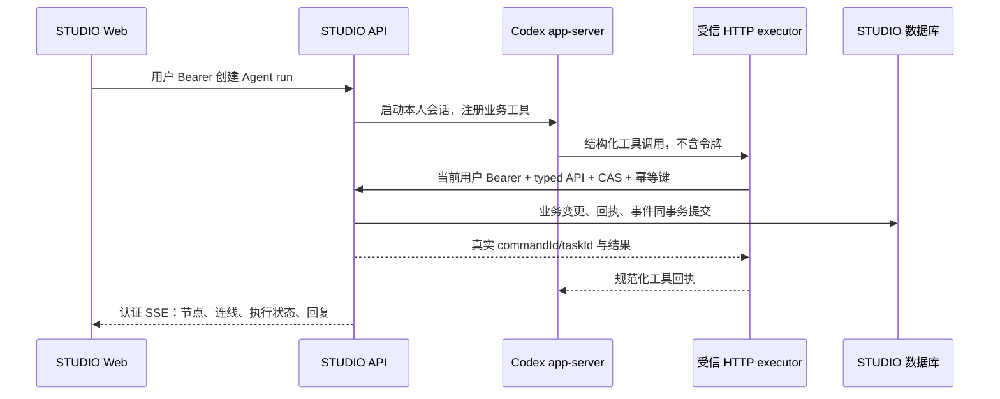

# Agent API 与实时画布协议

**完整目标为 DESIGN / RESERVED，2026-10-06。** 本文细化并更新 [直接 Codex 设计](codex-direct-agent-design.md) 的 API、身份和同步部分。机器可读草案见 [OpenAPI](../contracts/agent-canvas-extension.json)；现 v1 合同和已部署文本 run 接口不改。本轮已实现受限的普通节点/连线命令与回执切片，运行时以 [首批命令合同](../contracts/canvas-commands-implemented-extension.json) 为准；完整Agent run、工具身份、全画布事件流等目标仍待实现。另有 [有界画布上下文](../contracts/agent-context-extension.json) 供当前CANVAS会话读取。

## 1. 操作语义

2026-10-06 后续开发切片：一致 live-snapshot、有限 JSON 补读、旧 graph/revision 写入原子事件与草稿保护见 [基础记录](canvas-sync-foundation-2026-10-06.md)；有界 SSE、Web 增量同步与历史输入解析见 [最新实现记录](canvas-sync-and-inputs-2026-10-06.md) 和 [IMPLEMENTED 合同](../contracts/canvas-sync-implemented-extension.json)。下文 nodeStates、结果回写和 ToolBroker 仍属目标设计；当前事件只有 canvas.changed/canvas.invalidated，不能将其视为完整执行事件流。

Agent 使用**当前 STUDIO 登录用户的 Bearer access token**调用 STUDIO HTTP API，经过与 Web 相同的登录、实时 `tv.access` 和对象归属检查。新增节点、连线、模型生成等复用相同 application 用例，不维护第二套业务规则。



内置 Codex 不接收 token，也没有任意 URL、header、shell/curl 工具。executor 根据固定注册表选择 method/path/operationId、绑定身份、注入 token 并执行 HTTP 请求；不能信任模型自填的 owner。将来其他 Agent 客户端也可用本人有效 STUDIO token 直接调用公开业务协议，当前没有长期 PAT。

run 的当前画布是默认操作上下文，不是新的权限体系。工具可以显式选择本人其他作品/任务，仍走完整 owner 校验；不能未经说明就把用户权限缩成“只允许本 run 新建的数据”。首批工具只开放已实现的业务操作，不开放后台维护或 native Codex 管理 API。

## 2. 用户 token 生命周期

现状：access JWT 为15分钟，Web 只存内存；refresh 是 HttpOnly Cookie，单次轮换；本地 session 到期为建立时12小时与 IPAC 到期时间的较早值。每次业务 API 实时检查本地 session、IPAC SessionStatus、EffectiveScopes 和 `tv.access`，**没有缓存允许决定**。

1. 创建 run 时验证 Bearer，服务端保存 `ownerId + parentSessionId + conversationId + defaultProjectId`，私有 credential handle 持有本次 token。原始 token 不写普通业务表、日志、prompt、tool arguments、workspace、环境变量或原生 thread。
2. Web 沿现登录管理器刷新，再自动 `PUT /agent-runs/{id}/auth-context`。新 token 只放 Authorization；必须与 run 的 owner 和 local session 完全相同。If-Match 是此 auth-context 的 credentialEpoch；还要拒绝已验证 iat/exp 倒退，412后只用统一刷新管理器的当前凭证重试，不能拿旧 token 换新 epoch继续覆盖。相同 token重送为幂等无变化；expiresAt取JWT exp、父session到期与run deadline的较早值，不延长登录。
3. executor 不复制或刷新 Web 的 refresh Cookie，避免一次性刷新凭证重放撤销整个 session。v2 ProductClient 现无完整自动刷新链，实施时需接统一刷新管理器与 run credential 更新；不能宣称现有功能已覆盖。
4. 到期或进程重启丢失内存凭证时，run 为 `WAITING_FOR_AUTH`，暂停新操作；Web 自动补凭证后同 sid 恢复。新登录产生不同 sid，不静默接管旧 run；用户仍能查看历史、取消本人旧 run并发起新 run。
5. 退出、会话撤销或 `tv.access` 被撤销后，停止新工具；服务端每次 API 检查是最终防线。IPAC/数据库故障为可重试503，不误撤销健康会话。既已提交任务仍对账并保全产物，已提交画布修改不假装回滚；撤权后不发起新的图修改或结果回填。

不增加权限批准弹窗。`WAITING_FOR_AUTH` 是登录状态恢复，不是 Codex 扩权批准。未开放工具和扩权请求由后端拒绝。

## 3. API 与工具映射

表中“新增”均 RESERVED/设计；尚未注册的路径当前仍为404。将来注册但未实现时返回501，不能返回假成功。

| API | 用途与状态 |
|---|---|
| `POST /api/v2/conversations/{cid}/agent-runs` | 新增。提交已持久 USER messageId、模型精确版本/参数和当前画布修订；202返回 `data.id` 作为runId。独立路径保护现文本 `/runs` |
| `GET /api/v2/agent-runs/{id}`，`POST .../cancel` | 新增。真实 run 状态/取消请求；取消不等于撤销已执行操作 |
| `PUT /api/v2/agent-runs/{id}/auth-context` | 新增。绑定同用户同 session 的新 access token，token仅在请求头 |
| `GET /api/v2/agent/tools?runId=...` | 新增。工具名、输入 schema、对应 operationId、版本、可用状态及节点输入 schema；没有万能 call/proxy 入口 |
| `GET /api/v2/projects/{pid}/live-snapshot` | 新增。原子返回 graph、graphRevision、nodeStates、eventCursor；旧 v1 snapshot 读取继续保留 |
| `POST /api/v2/projects/{pid}/canvas-commands`，`GET .../{commandId}` | 新增。节点/连线/布局等 typed 命令和持久回执；Web 与 Agent 共用 |
| `POST /api/v2/projects/{pid}/canvas-executions` | 新增。从服务器当前画布创建 NODE/GROUP/CANVAS 生成任务，不接收自报 graph；202返回真实 taskId/execution markers |
| `GET /api/v2/projects/{pid}/events?after=...` | 新增。画布与节点执行 SSE/JSON 补发，包含 Web、Agent 和后台核实结果 |
| `GET /api/v2/agent-runs/{id}/events?after=...` | 新增。对话增量、工具调用和 run 状态；与项目事件序号独立 |
| 现 `tasks/detail/events/cancel`、`history`、`assets`、`model-capabilities`、`model-requirements`、个人库 API | 复用已部署合同。现 task events 是 JSON 回放，不冒充长连接 SSE；具体模型仍由已启用 adapter 决定 |

工具到 API 的固定映射如 `studio_canvas_read`→live-snapshot、`studio_canvas_patch`→canvas-commands、`studio_node_run/studio_workflow_run`→canvas-executions；模型目录、资产和历史工具直接复用对应业务 API。用户身份永远来自 Bearer。

可选 `agentContext:{runId,toolCallId}` 只关联服务端已登记调用。首次执行必须是pending call，核对owner/session、target和冻结请求摘要才记为Agent来源；已完成/终态call只允许核验原摘要后返回已有回执或查询，不再产生新副作用。自报source/runId/header不能制造身份、授权或可信审计来源。

## 4. 画布命令合同

```http
POST /api/v2/projects/prj_example/canvas-commands
Authorization: Bearer <当前用户 STUDIO access token>
If-Match: "42"
Idempotency-Key: <UUID>
Content-Type: application/json
```

```json
{
  "schemaVersion": "1",
  "operations": [
    {"type":"node.create","node":{"id":"node_text","nodeType":"rh-text","inputSchemaVersion":"1","position":{"x":120,"y":160},"inputs":{"title":"镜头1","text":"城市清晨"}}},
    {"type":"edge.create","edge":{"id":"edge_1","source":"node_text","target":"node_image","sourceHandle":null,"targetHandle":null}}
  ]
}
```

示例假设 node_image 已存在，nodeType/inputSchemaVersion 是目录提供的有效组合。HTTP 只用 If-Match 一个版本前提；工具中的 expectedRevision 由 executor 转换为该 header，不在 body 再放一个可能矛盾的值。

首批 operation：`node.create/updateInputs/move/delete/selectCapability/setParameters/bindAssets`、`edge.create/delete`、`group.create/setMembers/dissolve`、`viewport.set`。最后一项保存文档默认视角；远端更新不强制移动本tab相机。inputs依据节点类型的不可变输入schema校验并映射到原生格式；parameters依据精确模型能力schema；不提供通用JSON Patch路径或任意data merge。创建节点同样受白名单约束。

客户端不得写 owner、taskId、status、progress、error、outputs、historyStorage、服务器 execution marker、保留 meta 或 `__rhtv.native`。输入素材用 assetId，检查本人/READY；历史结果使用另行登记的受控用例，不用自报输出。未触及的原生扩展字段保留。连线端口、分组和依赖按实际节点类型校验，不把旧 graph 任意 data schema 当 Agent 输入 schema。

整批命令事务：验证当前用户/对象→幂等查询→锁项目并比较 revision→校验最终 graph与媒体→保存 graph/revision→保存回执→追加项目事件。任一步失败，整批不落地。

成功200的 `data`：

```json
{
  "commandId":"cmd_example","projectId":"prj_example","state":"COMMITTED",
  "baseRevision":42,"graphRevision":43,"eventCursor":"121",
  "delta":{"nodesUpsert":[],"nodesRemoved":[],"edgesUpsert":[],"edgesRemoved":[]},
  "committedAt":"2026-10-06T10:00:00Z"
}
```

这里只展示回执结构，实际 delta 必须含服务器真正提交的节点和边。沿现成功 envelope `{code:0,message:"OK",requestId,data}`，错误沿 `{code,message,requestId,retryable,details}`。

幂等域为 owner+project+operation+UUID，hash包含路径、规范 body、冻结 If-Match和已验证 Agent 关联。成功重放在再次 CAS 前返回原回执，但仍重查访问资格；同 key 不同参数409。Agent key由 run/tool-call 稳定派生。412后重新读取并重新制定命令，使用新 key；超时后用原 key重放/查询，不能新 key盲目重做。

## 5. 执行和真实节点状态

canvas-executions 只接 `target:{type:NODE|GROUP|CANVAS,id?}` 及合法选择；模型选择通常先写到节点。使用 If-Match，服务器取真实 graph、节点和输入引用，冻结 capability/schema版本、参数、feature PromptSpec/hash、输入 fingerprint 和节点 incarnation。接受任务与 execution binding、命令回执、项目事件同事务；网络/模型调用不在项目锁事务里进行。

202代表已接受排队，不代表模型开始或成功。`taskId`、各 plan executionId、taskRevision和plan状态 与真实输出回执才是依据。当前 task 五态 QUEUED/RUNNING/SUCCEEDED/FAILED/CANCELED 保持；取消意图、未知提交/对账是单独 phase，不能直接冒充 CANCELED/RUNNING。Agent 的工具执行状态与节点的生成状态分开。progress 未知为 null。

`nodeStates` 是服务器从执行记录产生的投影，不信任 graph 中客户端保存的 status。状态改变发项目事件；高频进度不递增 graphRevision，以免每次进度都打断用户保存。所有执行路径，包括旧 Web canvas-runs，也要接入同一 execution binding 和项目事件用例后再启用完整实时模式。

后台 `applyExecutionResult` 是私有业务命令，不向 Agent开放自填 output。核实 task/plan/asset归属、真实终态、输出 schema/字节后，比较当前节点 incarnation、active executionId和实际输入 fingerprint。只移动节点/改无关节点不阻止回填；改 prompt、模型、参考素材、有效输入连线或生成文本则不覆盖；删除后同ID重建也不是原节点。输出仍保留历史，记录 INPUT_CHANGED/NODE_DELETED/EXECUTION_SUPERSEDED等原因。

结果应用在当前图锁下保存 graph、新 revision、去重回执与项目事件。节点状态及结果由服务器负责，页面关闭也能落库；Web停止另一套自行持久回填，防止双写。已有功能 PromptSpec、结构化剧本/分镜投影、capability@1空参/省略effort及@2 Low/High默认Low继续保留。

当前保存上限与执行图上限不同，执行器还检查DAG。新的执行入口必须明确选择/依赖闭包及实际执行上限，不能把整幅大图无条件传进现500节点/2000边的解析器；没有适配的节点/功能返回不可用，不假装覆盖全部原站功能。

## 6. 实时事件与恢复

采用 **带 Authorization 的 fetch SSE**；不把 token放URL。命令仍走HTTP，服务器单向推送可用 SSE。事件使用标准 `id/event/data`，心跳是 comment。[SSE协议参考](https://developer.mozilla.org/en-US/docs/Web/API/Server-sent_events/Using_server-sent_events)

live-snapshot 在一致数据库快照中返回 graph+nodeStates+eventCursor，然后订阅 `after=eventCursor`，两步之间的写入由持久事件补齐。每项目 sequence连续递增，十进制字符串避免JS精度问题；不拿 graphRevision或某个 task sequence代替。

| 项目事件 | 内容 |
|---|---|
| `canvas.changed` | commandId、baseRevision/new graphRevision、服务器 normalized delta：增改删节点和边 |
| `canvas.invalidated` | 大 delta 超过传输上限时给 revision/commandId；客户端取 live-snapshot 后重基本地草稿 |
| `node.execution.changed` | nodeId、incarnation、taskId、executionId、taskRevision和plan状态、state/phase、可空进度 |
| `node.result.applied` | 同一次 graph mutation 的delta、outputIds/assetIds、execution关联，不再另发第二个重复 canvas.changed |
| `node.result.not-applied` | 历史输出引用与未应用原因，graph不变 |

所有事件含 schemaVersion/projectId/sequence/occurredAt；可信 source可关联 runId/toolCallId，原生 thread/turn、token、路径和长期下载URL不公开。delta也须表达顶层viewport，客户端推进base而保留本tab实际视角。`graphRevision`复用现`projects.revision`作为CAS别名，该字段也被作品移动递增；这些非graph writer同样必须产生事件，不能漏推进版本。无法表示的变更发canvas.invalidated（REVISION_ONLY/UNREPRESENTABLE_CHANGE等），不能发空delta假装完整同步。Agent事件另提供message.delta/tool.started/tool.completed/run.state.changed/task.linked；两种流不可混用cursor。每页最多项目流+当前Agent流，不为每个节点再建连接。

事务落地事件表，提交后唤醒 tail；NOTIFY只是唤醒，不能当消息持久化。SSE先补发再tail；JSON Accept提供同序号分页恢复。Last-Event-ID和after冲突时400，重复投递按sequence去重，gap先补发再应用；保留期外410 EVENT_CURSOR_EXPIRED，重新取一致快照。心跳不占序号；断线退避，队列过大断开后补发。目标是内网正常情况下提交后1秒内可见，需实施后实测。

服务端冻结建连Bearer的已验证exp，并在JWT/session有效截止时间强制关闭流，不能依赖客户端重连或只凭较长session期限继续推送。Web用新token重连并补发；数据批次发送前/周期性复核会话和权限，退出/撤权关闭关联流。401/403停止读取及新命令，503暂停并退避，不能继续发送私人数据。已打开流不能再改HTTP状态：可发无id的stream.error后关闭，新HTTP请求取得正式错误；控制事件不推进cursor。CORS需新增Last-Event-ID允许项；反代关闭缓冲、允许持续flush。连接断开不取消已接受生成任务。

## 7. Web自动保存与多标签页

**当前问题：** `storage.queueSave` 提前冻结整图，执行 save 时才读取共享最新ETag。若只把Agent事件的revision写入etags，旧整图就可能带新ETag合法覆盖新节点。

改为 `acknowledgedBaseGraph + baseRevision + eventCursor + localDraft + pendingOperations`。每个本地变更绑定产生时的base；远端事件和HTTP回执通过同一处理入口推进base，不直接换ETag后提交旧快照。

1. 收远端变更时暂停旧队列。已发请求保留原CAS；未发的旧整图任务作废并转成有base的本地差异。
2. 先把delta应用到base，再三方合并base/local/remote。不同节点/字段可重基；同字段冲突、删节点vs编辑、分组vs相对位置等保留本地草稿并暂停冲突部分，不丢输入或自动拼接文本。
3. 合并后只把仍成立的本地typed operations用最新revision/new key提交。不得“旧整图换新ETag重试”。HTTP/SSE先后乱序按commandId+revision去重，事件缺口先补齐。
4. 远端更新通过原生manager/Yjs桥的remote origin批量应用，抑制再次dirty/autosave，避免事件回声。模型版本sidecar及媒体URL解析随base同步；不改冻结资源。
5. 保持本tab视口、选中状态和光标；Agent移动节点不自动抢视角。每tab各有draft/cursor/attachmentEpoch，切画布或换用户立即abort旧流与队列。

所有图写入口都进同一CanvasFacade；旧v1整图PUT保留合同和CAS，但服务器保留/校验执行字段，不允许借整图写状态/伪输出，并产生项目事件。新部署Web在自有桥接层分离editable输入与server projection；兼容旧整图客户端必须验证，不保留一条绕过保护的双写通道。

## 8. 数据与实施边界

在原方案run/tool/event/runtime表之外，仅增画布必要记录：`canvas.command_receipts`（幂等/hash/修订/delta/回执）、`canvas.project_events`（owner+project+sequence/type/payload）、`canvas.node_executions`（节点incarnation、执行binding、输入fingerprint、核实状态/结果应用）。项目行新增event_sequence，在项目锁内递增；相关owner/project复合约束不省略。旧表不就地重写迁移。

跨上下文由application ports和共享UoW保证短事务；若执行事件使用outbox投影，则live-snapshot必须读取同一已提交project read model与cursor，不能拼未经投影的最新task状态造成事件缺口。Agent与生成worker分开，防止Agent等待子任务堵住领取队列。

实施顺序：①认证HTTP executor/run credential；②CanvasFacade+typed commands+原子回执/项目事件；③服务器executions/result apply；④Web队列重基+fetch SSE恢复；⑤迁入Codex tools并端到端验收后切新任务，旧Router任务继续收尾。单独有SSE不算本功能完成。

最低验收：同用户Agent/Web等价操作；跨用户猜ID拒绝；token刷新/退出/重启；Agent新增时旧autosave仍排队；两个tab并发；HTTP/SSE乱序重复；断线补发/cursor过期；生成过程中改prompt/删节点/同ID重建；浏览器关闭后结果持久化；未知模型提交不重复生成；刷新后的图、状态和全部tab一致。原菜单、动画、图形和预设提示词不变，无费用/批准页面。
