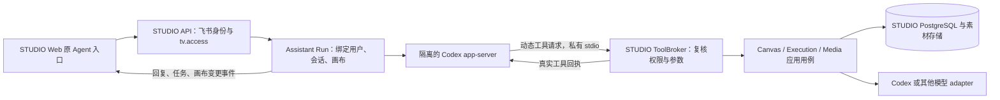

# Studio TV 直接集成 Codex 与画布 Agent

状态：**DESIGN，2026-10-06**。本轮核查现有代码和 deployment-host 的 Codex 0.160.0 协议；未切换服务、删除 Router 或调用模型。本文取代独立 Router 作为 STUDIO 新调用链路的设计方向；现有型号/提示词设计中与供应商无关的部分继续适用。

## 1. 决定

STUDIO Go 后端直接管理 Codex app-server。去掉新请求的 STUDIO→Router HTTP 链路和独立 Router 业务数据库依赖，保留 STUDIO 内部的 `ModelGateway`、模型目录和执行器 ports。将已有 Codex 协议、提示词映射、图片验证及未知结果对账代码迁入 STUDIO adapter；以后 H3、vLLM Omni、SGLang 和厂商 API 也是这个内部边界的 adapter。

后端框架继续用 chi/pgx，PostgreSQL 和 Docker 保留。换 Kratos 不能替代本次所需的会话隔离、工具执行和画布并发规则。

“同 workspace”落实为**同一 STUDIO 工程和部署管理、用户专属的运行 workspace**。API 与 Codex 不共用宿主进程身份、API 环境变量、公司开发目录或全量素材目录。公司 Codex 登录凭据只供受控模型运行时使用，与飞书用户身份分开。



按后续明确的 API 设计，内置 Agent 由受信 HTTP executor 持有当前 STUDIO 登录用户 Bearer，调用正式 STUDIO HTTP API，再进入与 Web 共用的 application facade。token 不交给 Codex，用户身份也不由模型参数提交。详细接口、凭证更新和实时同步见 [Agent API 与实时画布协议](agent-api-and-live-canvas-design.md)。

## 2. 现有能力和缺口

| 部分 | 已有 | 本次要补 |
|---|---|---|
| 登录与权限 | 飞书/IPAC，工具级 `tv.access`；业务资源按 owner 隔离 | Agent run 的服务端身份绑定；每次工具操作复核有效访问资格和对象归属 |
| 画布 | 本人 snapshot GET/PUT、强 ETag、保存时版本比较、媒体归属校验 | application facade；节点/连线等受控命令、幂等回执；服务端撤销另建补偿规则 |
| 生成任务 | execution 任务、租约、事件、历史、结果入库；功能 PromptSpec | 从服务器画布读取并校验 expectedRevision 后创建 Agent 子任务；直接 Codex adapter；后台结果应用命令 |
| 会话历史 | 本人 conversation/messages、修订与幂等；execution assistant-runs 已提供持久模型调用和回复 | Assistant 的完整 Agent tool loop、工具日志和事件；assistant 模块仍有 RESERVED 占位，不能据此将组合部署的 run 路由当全部未实现 |
| Codex | text/vision/image adapter、隔离目录、净化环境、私有原生回执 | 用户运行容器隔离；dynamic tool 回调、工具事件和完整 thread snapshot 校验 |
| Web Agent | 原入口、原四种工作方式和模型选择桥接 | 接 run/events；画布变更同步；不增加批准握手 |

代码依据：`apps/api-go/internal/core/projects.go`、`modules/execution/application/service.go`、`modules/execution/adapters/http/routes.go`、`modules/execution/adapters/postgres/store.go`、`modules/assistant/adapters/http/routes.go`。现 Router 的 `codexappserver/rpc.go` 一律拒绝 server requests，`events.go` 的文本 profile 不接受工具 item；不能仅改模型名字就声称 Agent 已能操作画布。

## 3. 身份绑定与运行隔离

创建 run 时，从已验证 STUDIO 登录会话解析稳定的 `ownerId`，检查 `tv.access`、会话归属和画布归属，再冻结：

```text
ownerId + parentSessionId + conversationId + defaultProjectId + runId
+ modelSelection + promptTemplateHash + toolSchemaHash + runtimeProfileVersion
```

工具参数不提供 `ownerId/userId`、登录令牌、任意 URL/header、SQL、宿主文件路径或原生 threadId。ToolBroker 从绑定记录取 actor 和默认画布，检查回调的 thread/turn/call 是否匹配当前 run；可显式选择本人其他作品/任务，仍完整检查归属。不能靠“仅访问用户A数据”的提示词实现隔离。

用户访问资格由每次用户 Bearer HTTP 请求复核，不能把 owner 字符串当已认证证据。复用现有实时 SessionStatus、EffectiveScopes、Runtime Check 与本地 session 撤销策略，当前没有缓存允许决定。access 到期暂停新工具，Web 在同 uid/sid 自动刷新后更新私有凭证；失效后停止新操作并收尾已提交任务。未来若另做内部委托 grant，需独立协议并保持父会话检查，不把它冒充当前已实现的用户 token。

每个用户的运行容器只挂载自己的运行状态；每个会话/profile 再分目录。持久 Codex HOME 与线程映射留存，进程可按需启动、空闲退出。与 API 隔离 PID/mount/network，使用非 API 的运行身份，无宿主 Docker socket、STUDIO DB 密钥、STUDIO API cookie、开发源码或其他用户卷；配置 CPU、内存、磁盘和执行期限。API 本身不持有任意容器创建能力；运行调度只接受服务端定义的固定 runtime spec。

Codex 自身 sandbox 是第二层限制。画布 Agent 使用只开放 STUDIO 工具的固定 profile，关闭 shell/unified exec、文件修改、浏览器、外部 apps/plugins/MCP、hooks 和非必要环境工具。配置由服务端生成，不加载上传内容中的配置/AGENTS/skills。配置开关不视为充分证明：上线前必须验证固定版本的实际工具可见性和逃逸拒绝行为。

运行时访问模型服务的必要网络，与 Agent 可调用的业务工具分开；前者由部署的出口策略控制，后者只有 STUDIO ToolBroker。原生 app-server 不开放 TCP 给浏览器，不透传原生 RPC，尤其禁止 `thread/shellCommand`、`command/exec`、`fs/*` 和修改运行配置的管理方法。

## 4. 不弹权限批准

使用 `approvalPolicy: "never"`，STUDIO 明确开放的业务工具在校验后自动执行。越权、未知工具和运行时扩权请求直接返回受控失败；不能通过统一 `accept` 自动批准扩大权限。

命令、文件、权限和 MCP elicitation 请求分别按固定协议作拒绝响应；未知方法返回未支持。业务参数不足可以作为正常对话询问用户，但不存在 Codex 权限批准弹窗，也不要求用户登录公司 Codex 账号。

公司订阅失效或额度不足时，返回明确的模型不可用错误，由服务端维护公司账号，不将维护流程转成 STUDIO 用户的权限批准。

## 5. Codex 动态工具接入

deployment-host **0.160.0** 的 experimental schema 已只读核实：`initialize` 开启 `experimentalApi`，`thread/start.dynamicTools` 注册函数。工具请求是 `item/tool/call`，包含 `threadId/turnId/callId/tool/arguments`，可含 namespace；回应用 `success` 与 `contentItems`，文本项为 `inputText/text`。

```json
{
  "type": "function",
  "name": "studio_canvas_read",
  "description": "读取当前用户绑定画布的节点、连线与修订",
  "inputSchema": {
    "type": "object",
    "properties": {},
    "additionalProperties": false
  }
}
```

画布工具可省略 projectId，采用 run 的默认画布；显式 projectId 仍需属于当前用户。run/project 上下文不是另一套身份凭证；不提供通用 HTTP 代理绕过业务校验。

当前固定版本 `thread/resume` schema **没有** `dynamicTools` 参数。工具集合、参数 schema 和 hash 随 thread epoch 固定；工具协议变化时新建 thread 并重建已授权的历史上下文，不按新版文档假设可热更新。

回调交给有界执行队列，不在 RPC 读循环中等待耗时业务。`item/started/completed` 的 `dynamicToolCall` 和 thread 完整快照须做独立 Agent profile 验证；普通文本 profile 继续拒绝工具。以 STUDIO 工具日志里的真实执行结果判定成功，不信任模型回复“已完成”。

## 6. 首批工具与覆盖方式

下列名字为提议，全部为 DESIGN。先实现画布工作流，再逐项登记剩余业务用例；不提供万能 HTTP 工具。

| 工具 | 参数主体 | 结果与校验 |
|---|---|---|
| `studio_canvas_read` | 可选节点范围 | 本人当前画布 revision、节点、连线；媒体只给已授权引用 |
| `studio_canvas_patch` | expectedRevision、typed operations | 支持增/改/删节点、增/删连线、移动、分组；验证允许修改的字段、图结构、类型、引用和版本，返回新 revision 与 actionId；禁止伪造 owner/任务状态/生成结果 |
| `studio_model_list` | featureCode、inputKinds | 按当前功能兼容性返回真实可用模型、版本、推理档位和有效默认 |
| `studio_node_run` | nodeId、expectedRevision；合法功能选择 | 从本人服务器快照解析节点和引用，冻结模型/参数/PromptSpec；返回异步 taskId |
| `studio_workflow_run` | nodeIds 或 groupId、expectedRevision | 由 execution 校验依赖并创建任务；不接受 Agent 自报整图替代当前画布 |
| `studio_task_read` / `studio_task_cancel` | taskId | 沿 Web API 检查当前用户的任务和父级归属；真实状态、结果/取消状态 |
| `studio_asset_read` | assetId、有限 detail | 验证 owner/READY/引用资格，返回元数据或限量图片输入，不给文件路径和长期公开 URL |
| `studio_library_list` / `studio_library_insert` | 分类/分页或 itemId、expectedRevision | 按私人/公司目录可用规则读取；插入后再次检查媒体归属和画布版本 |

图像、视频、动作模仿模式继续调用相应的业务能力；Agent 模式负责编排这些能力。例如“拆成分镜并生成图片”：读画布→添加文本/图片节点和连线→调用 STUDIO 已定义的分镜/生图功能→查询任务→将核实输出关联节点。

人物三视图、草图、风格等功能依然由 STUDIO 选择既有功能预设和系统提示词，不让 Agent 重写成普通生图调用。未配置的视频/特定编辑模型返回不可用，不能因有 Agent 自动变成支持。

视口移动、选中、预览等纯 Web 行为需要单独的有限客户端工具。它们不替代服务器的数据修改、鉴权或生成结果；浏览器回执不能赋予写数据权限。覆盖“任意画布功能”须逐个映射现有功能和 API，不能靠一个函数直接获得全部能力。

## 7. 并发、幂等、恢复与撤销

- 每次画布命令带 expectedRevision；冲突时重新读并重新制定 patch，禁止覆盖用户新编辑。保留 graph 的原生扩展字段和现有媒体引用校验。
- ToolBroker 用 `(runId, nativeCallId)` 派生稳定操作键，冻结 canonical argument hash，包含 expectedRevision。同键不同参数拒绝；同键重放返回同一业务回执。当前 snapshot PUT 没有这个幂等机制，现通用幂等 hash 也未涵盖 If-Match，需要补到新 command facade，不能直接包现有 PUT 声称完成。
- 命令保存、修订递增、操作回执和画布变更事件在同一 STUDIO 事务提交；或使用下游命令的持久幂等回执进行恢复。进程中断后先核对回执，已执行的写操作不重复做。
- `run_node` 返回异步任务，不重入正在处理 Agent turn 的同一个 Codex thread/transport；文本/图片生成使用独立、同 actor 的生成 profile。当前 execution worker 单循环同步执行，Agent 等待子任务会阻塞领取；新增独立有界 Agent worker 和生成 worker，或持久让出等待。模型提交结果不确定先对账，不能自动新发一次。
- 当前结果回填主要在 Web `src/service/execution.ts`，后台 Agent 需要服务器结果应用命令：只有核实过的任务输出可按 execution marker 和节点内容/修订回填。用户改动或删除节点后，结果保留历史，不能覆盖新内容。
- Web 消费有序 `canvas.changed` 与任务事件；没有本地编辑时回填，有未保存修改时执行版本合并/重新同步。不能仅刷新整个画布丢失未保存输入。
- 取消停止新工具和未提交任务；已经成功提交的修改不会假装回滚。服务端撤销目前不存在，后续以 actionId、before/after、inverse operations 和 revision 条件实现补偿，不覆盖其他用户操作或清除生成文件。

每个会话只有一个活动 Agent run；不同会话仍通过画布 revision 处理并发。运行设置工具调用数、生成任务数、时长/资源上限，超限自动收尾并报告状态，不增加批准步骤。

## 8. DDD、表和接口

`assistant` 管 Run/ToolCall/事件，`canvas` 管 graph 命令，`execution` 管生成任务，`media` 管资产。`modelgateway` 定义模型能力和 runtime ports；`adapters/codexappserver` 负责原生协议。domain/application 不 import Codex transport、HTTP 或 pgx；bootstrap 显式装配。

沿用现 conversation/messages、projects.graph、execution task/history、assets。以下是模型与 Agent 的 **5 表**；后续实时画布协议另需命令回执、项目事件及节点执行 binding，见 [增量设计](agent-api-and-live-canvas-design.md)。不一次创建全量蓝图：

| 表 | 主要字段与约束 |
|---|---|
| `assistant.runs` | id、owner、conversation、project、state、selection/prompt/tool/profile 快照、lease、deadline；会话仅一个活动 run |
| `assistant.tool_calls` | run、owner、native_call_id、tool、args_hash、state、action/task 引用、result；run+call 唯一；原生字段私有 |
| `assistant.events` | run、owner、sequence、type、data；run+sequence 唯一；只保存规范化可公开事件 |
| `model_runtime.bindings` | owner、conversation 或 invocation scope、profile、epoch、tool/prompt hash、私有 thread/checkpoint/workspace 映射；归属不能变更 |
| `model_runtime.receipts` | owner、operation、attempt、accepted_hash、native_turn、提交/终态证据、usage/context；owner+operation+attempt 唯一，同 operation 请求摘要不可改变；UNKNOWN 先对账，不能凭新 attempt 重新生成 |

内部 lease/fencing、唯一索引和带 owner 的外键保证重启/并发一致性；原生凭据仍是外部秘密文件，不进这些表。完整 graph 操作撤销的 durable action ledger 另做增量，不能把“有工具日志”等同于已有撤销功能。

现 frozen v1 不改。新增 Agent 扩展合同为 run/detail/events/cancel 补齐完整工具工作流，保留已部署的 execution assistant-runs 与历史合同，明确路由装配和模式分派，不能覆盖已有文本调用行为。Web 不调用 native app-server，也不提交服务器工具结果；已有 tool-result 预留路由不作为批准通道。

模型目录从 app-server `model/list` 加 STUDIO 启用策略投影：完整型号、输入能力、支持的 effort、默认、可用状态分开。请求冻结具体型号和 effort 并返回 resolved/observed 信息；不把发现但未验收的能力当可用。Ultra 涉及子 Agent，须先让所有子线程继承相同身份、工具和预算，不能只增加一个选项。

用户历史以 STUDIO DB 为权威，持久原生 thread/checkpoint 为私有执行状态。换模型/工具 profile 创建 epoch，需要重建上下文时从已授权 STUDIO 历史读取；不能复用公司账号下其他用户 thread。用量/context 按实际观察记录，未知为 null；订阅额度不是用户费用。保留隐藏积分/充值元素的现状。

## 9. 系统提示词和 Web

STUDIO 继续编译 feature/promptSelection → versioned PromptSpec；保持 SYSTEM→baseInstructions、DEVELOPER→developerInstructions、模板版本/hash 和结构化输出约束。工具说明是服务器生成的 Agent 配置，画布文本、用户提示、参考图和工具返回内容不能覆盖策略。浏览器不能提交原生 config、workspace、collaborationMode 或权限参数。

保留已接受的 capability/schema/prompt/history 精确版本，包括现 capability@1 空参数且省略 effort，@2 Low/High 且默认 Low。新 adapter 不能把旧任务补成新的型号默认或推理档位；完整档位扩展另发不可变版本。

原 Agent/图像/视频/动作模仿模式、下级模型菜单、原参数面板、按钮、动画和图形保持。型号和合法 reasoning 选项仍在合适的原入口投影；模型名称改变不改变工作方式。新增 backend run/events 接到自有桥接代码，不改冻结编译资源、不加 workspace/权限/费用面板。

## 10. 迁移与验收

1. 在 STUDIO 内迁入已验证的 Codex protocol/runtime/image 部分，重接本地 receipts、目录、媒体输入与已授权资产导入。Go `internal` 包不能跨仓库直接 import；不要复制 Router 的公开 job/session/auth HTTP 层。
2. 实现画布命令 facade、expectedRevision 生成入口和 actor-bound ToolBroker；独立 Agent profile 验证动态工具及持久恢复。
3. 建运行容器边界并接 Web 原 Agent 流；验证后切换新请求到 direct adapter。每个接受的任务冻结 adapterKind；同一个请求不能向两个上游双发。
4. 旧 Router invocation/session/artifact refs 保持可读和可对账；在途任务继续由原 adapter 收尾。旧会话必要时在 STUDIO 已授权历史基础上创建 direct epoch；迁移原生状态需要完整 owner/profile/hash 校验，不能仅替换字符串引用，也不能让两个服务同时写同一 Codex HOME。
5. 旧任务收尾且历史资产都已进入 STUDIO 后，才停止 Router 容器。保留仓库和受控归档数据库供回溯；当前不直接删服务、数据或公司登录状态。

最低验收：A/B 用户互相猜项目/素材/任务/会话 ID 仍拒绝；篡改回调 thread/turn/tool/namespace 不执行；无 shell/fs/native RPC 绕过；Web 无批准流程；读画布→增节点→连线→真实生成→回填→重新登录历史一致；人工编辑/CAS 冲突不丢数据；重启/重放不重复修改或生成；取消和未知提交正确收尾；模型/effort 实际生效，既有功能模板 hash 不变，旧任务历史可读。

协议参考：[Codex app-server](https://learn.chatgpt.com/docs/app-server)、[sandbox 与批准策略](https://learn.chatgpt.com/docs/sandboxing)。动态工具属于 experimental，依固定版本 schema 做协议测试。本文没有将设计字段或表标成 IMPLEMENTED。
