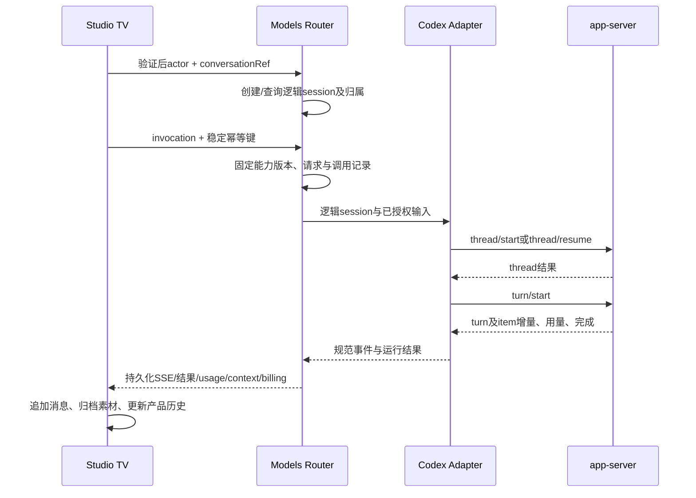

# Codex app-server 适配器设计

2026-10-05。此文仅说明Codex这一种Agent适配器；Router的LLM、图像、视频与自部署框架边界见[总体设计](models-router-design.md)。该适配器是后续切片方案，尚未运行真实Codex推理。已核对本机codex-cli 0.159.2生成的JSON Schema及[官方app-server文档](https://learn.chatgpt.com/docs/app-server)。字段属于该版本协议，不把Schema里标为Internal-only的raw response事件当成稳定外部依赖。

## 服务如何包装app-server

app-server是Codex agent运行时的双向JSON-RPC接口：thread承载长期会话，turn承载一轮用户请求，item承载文本、工具过程等。Router中的Codex adapter通过stdio驱动它，初始化后创建或恢复thread，再启动turn、接收增量/完成事件并转为统一HTTP/SSE。模型生成和工具执行由runtime处理；具体允许哪些工具由能力profile定义，剧本聊天不因此获得任意文件或命令访问权限。[官方协议与生命周期](https://learn.chatgpt.com/docs/app-server)



Router对PF不暴露stdio、JSON-RPC method或本机路径。未来其他产品也使用相同协议，只配置各自clientApp与服务身份；厂商HTTP、本地模型、Codex或其他agent分别实现adapter。

## ID与归属

| ID | 谁生成/保存 | 生命周期 |
|---|---|---|
| clientApp | Router登记服务调用方 | 长期，如studio-tv、其他内部产品 |
| subjectRef | 产品从可信登录映射取得 | 稳定用户，不用某次登录sessionId |
| conversationRef | 产品创建/保存 | 一段长期多轮对话，独立于页面和浏览器登录 |
| sessionRef | Router持久创建 | (clientApp,subjectRef,conversationRef)自然键唯一 |
| invocationRef | Router接受执行时创建 | 某一轮请求；幂等重放返回同一个ID |
| native threadId/turnId/itemId | app-server创建，Router私有映射 | 原生运行时的长期会话/本轮调用/输出 |
| requestId | 每次HTTP或RPC交互生成 | 网络诊断，不能用作业务去重或会话归属 |

Router校验服务token、该token允许的clientApp及actor签名；session读取、运行、事件、文件均匹配clientApp+subjectRef。签名覆盖方法、原始URI、actor、时间、nonce、body hash和调用幂等键。拿到别人sessionRef仍不能访问；数据库唯一绑定避免同逻辑session转绑用户。

例：A首次登录，经IPAC身份映射得到PF长期用户usr_A，创建conv_1。Router将(studio-tv,usr_A,conv_1)绑定session_1，Codex adapter再绑定其私有runtime namespace/thread。A发送三次消息，分别生成三个invocation及对应turn；第二天登录变化的是登录session，usr_A/conv_1保持稳定，PF先返回自己的历史，再恢复session_1。B拥有自己的用户、对话和原生存储命名空间，不能靠更换页面参数进入A的thread。

首页剧本对话应使用产品GLOBAL会话类型，projectId为空；画布对话使用CANVAS并绑定本人作品。二者复用同一messages结构和Router协议，不因首页没有画布而制造假project。GLOBAL是本次补充的产品能力，需要与迁移和合同一起实现。

## 用量、上下文、费用分开返回

本机0.159.2的ThreadTokenUsageUpdatedNotification包含threadId、turnId，以及tokenUsage.last/total；计数项包括inputTokens、cachedInputTokens、cacheWriteInputTokens、outputTokens、reasoningOutputTokens、totalTokens。modelContextWindow允许null。原生字段需要先经过adapter的语义核对再规范化，不能把last直接称为整个PF请求的全部消耗。

| Router信息 | 用途与规则 |
|---|---|
| usage（scope=INVOCATION） | 当前调用消耗；有来源及覆盖范围，未知字段为null |
| usage（scope=SESSION） | Router接受并归属该session的累计消耗；与导入的旧原生历史基线区分 |
| context.windowTokens | 当前实际模型的上下文窗口；没报告则null，不靠模型名称猜定 |
| context.usedTokens | runtime提供的上下文测量或明确标注的估算，不用累计usage.total替代 |
| context.remainingTokensEstimate | 估算可用空间；注明测量方法、输出预留和最近更新时间 |
| context.compactionCount | adapter已观察到的压缩次数；未知为null。压缩不删除PF产品历史 |
| billing | 实付、估算、包含于套餐或未知；金额为十进制字符串，带币种和价格版本 |

若只有thread级累计token计数，按接受turn前后的快照差归属本轮，标source=DERIVED；多次更新不能累加重复的累计数，重连不能再记一遍。reset、导入、分叉、压缩和模型切换需要新计数epoch/基线。一个agent turn可能多次调用模型，且有子agent；coverage必须说明是否只含主thread，不能漏记后声称完整费用。

剩余上下文不是“窗口减去历史累计消耗”。只有可靠当前上下文测量时才能按窗口、使用量及输出预留计算；使用last usage作为代理时标ESTIMATED并说明算法，不能当作精确剩余。切换模型或压缩后重新发布测量。PF可据此显示剩余估算、数据时间及是否已压缩。

Token消耗也不等于账单。没有实际费用数据时actualAmount=null；仅在具备明确计价规则与价格快照时提供estimatedAmount。订阅额度/共享上游账号的使用限制是账号范围信息，不等于A个人已消费金额或额度，不应冒充PF用户预算。

图像/视频或本地GPU服务还可以用usage.units表达IMAGE、VIDEO_SECOND、GPU_SECOND等计量，数量为十进制字符串并注明来源。缓存输入属于输入分类、推理输出属于输出分类，规范化后不能把分类值与总输入/输出重复相加。统计还应带观测时间、是否部分/最终数据，避免把中途更新当最终账单。

统一响应示意（尚未接runtime，所以未知值保持null）：

```json
{
  "invocationRef": "invocation_1",
  "sessionRef": "sess_AAAAAAAAAAAAAAAAAAAAAAAAAAAAAAAA",
  "state": "QUEUED",
  "execution": {
    "capabilityRef": "chat.script",
    "version": "1",
    "executionKind": "AGENT"
  },
  "usage": {
    "scope": "INVOCATION",
    "source": "UNAVAILABLE",
    "coverage": "PRIMARY_THREAD",
    "inputTokens": null,
    "cachedInputTokens": null,
    "cacheWriteInputTokens": null,
    "outputTokens": null,
    "reasoningOutputTokens": null,
    "totalTokens": null
  },
  "context": {
    "windowTokens": null,
    "usedTokens": null,
    "remainingTokensEstimate": null,
    "reservedOutputTokens": null,
    "measurement": "UNAVAILABLE",
    "compactionCount": null,
    "observedAt": null
  },
  "billing": {
    "mode": "UNKNOWN",
    "currency": null,
    "actualAmount": null,
    "estimatedAmount": null,
    "pricingRevision": null
  }
}
```

上例用于说明字段，实际机器合同以[Router合同](../contracts/models-router.yaml)为准；当前invocations仍返回501，没有伪造的QUEUED任务。以后增加usage.updated、context.updated等规范事件，PF按持久序号消费，结果中的统计快照用于恢复，不能只依赖浏览器实时收到的事件。

## 作为公司infra的能力目录

能力由kind描述用途（LLM、图像、视频等可扩展代码），executionKind描述MODEL或AGENT。同是LLM，普通推理与带工具/多步规划的agent是不同能力profile。目录发布版本化参数schema、输入输出类型、session/流/取消/工具支持及运行可用性，产品据此构造表单与行为。

目录可以表达chat.script、image.generate、video.from-image等稳定接口，但并不承诺它们共享相同原生记忆。Router统一输入parts、运行、结果、artifacts、工具请求及统计；不支持的能力显式报错。适配器可在同协议下替换，新增不可兼容的输入/行为用新能力版本。

PF继续拥有作品/历史/业务工具及素材长期归档；Router持有逻辑session、原生映射、调用账本、统计来源、输出交换及技术恢复。Router不接管每个产品的业务表，也不直接对浏览器开放上游账户。

## 崩溃与持久化

Router保存session与invocation账本；Codex runtime的thread存储/工作目录使用独立持久卷，并记录runtime身份和用户命名空间。只有映射表而没有原生存储，无法声称同thread恢复。用户文件区和工具profile按实际隔离策略运行，不能把整台开发机的home挂给所有用户。

HTTP幂等键由Router负责；JSON-RPC id只是关联请求响应，不代表原生turn/start具备幂等保证。收到turnId后立即持久关联。提交成功但回复丢失时，进入UNKNOWN并核对原生thread状态/历史，不能仅因worker重启就再次发turn/start。本机schema包含clientUserMessageId，但它的去重语义尚未验证，不把它当已证明的exactly-once机制。

首个Codex切片应先用受控新建thread验证两个actor隔离、多轮续聊、重启恢复、断流补发、取消、统计归属与未知状态；已有个人桌面session的IMPORT/FORK/RESUME在此基础上推进。适配器的真实推理调用尚未启用，本次协议核对只生成本地Schema。
