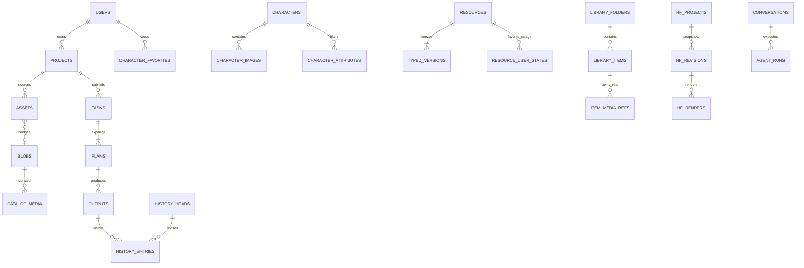

# Studio TV 数据库设计

2026-10-05。数据库继续使用 PostgreSQL 17；按 DDD 模块划分 8 个 schema、57 张新表，复用现有 `public` 表。字段、约束与索引以 [SQL 蓝图](design/database.sql) 为准；领域及接口见 [后端设计](backend-design.md) 和 [领域 API](api-domain-design.md)。

这是完整规划DDL，**不是运行时migration**。第1轮004只新增assistant.conversations/messages，支持GLOBAL/CANVAS、owner隔离与可空Router引用；实际接口见[会话切片](assistant-api.md)。后续蓝图须逐项与已实施迁移合并，不能在004之后直接执行整份蓝图SQL。

可视建模见 [分模块 ER 图与16表首期建议](database-er.md)、[完整 DBML 源文件](design/database.dbml)。57是全量功能展开数量，不是DDD要求的表数。

会话按owner隔离，职责见[Router设计](models-router-design.md)。蓝图尚未合并Router引用/上下文字段；004实际切片已预留成对Router引用，原生会话与执行账本属于Router独立库。

## 1. 复用与通用规则

| 现有对象 | 复用方式 |
|---|---|
| `users` / `federated_identities` | 本地 UserID 与 IPAC issuer/subject 绑定；头像姓名正常显示，不新增业务 RBAC、工作空间或租户。 |
| `sessions` / `refresh_tokens` / `oidc_login_transactions` | 继续正式 OIDC 登录、刷新、撤销、单次登录事务与会话版本校验。 |
| `projects` | 原画布聚合：owner、graph JSONB、revision、ETag 与软删除保持。 |
| `assets` / `asset_uploads` | 继续 IMAGE/VIDEO/AUDIO 真实上传、READY 校验与签名访问；3D/文档不塞进原 kind。 |
| `idempotency_keys` | 复用 owner+operation+key 和请求 hash；新增能力采用相同幂等规则。 |
| `ipac_workspaces` / `projects.workspace_id` | 003 遗留元数据保留；不改旧迁移、不回填新项目、不参与新表和授权。 |

SQL 对 `public` 只增加 owner 复合唯一/FK约束、保留字 owner 检查及 `assets.blob_id` 可空桥接，不重新建上述表。Asset→Project、Upload→Asset 补同 owner FK；正式迁移先核对存量异常。当前 v1 服务已有 owner 校验。原 storage_key 仍有效；后续先登记/验证原文件、回填 blob_id，再切读路径。

ID 沿用 text；修订号 bigint；时间 timestamptz/UTC；状态 text+CHECK。客户端不能提交可信 owner，所有私有资源从登录身份确定 owner，API 统一检查工具级 `tv.access`。

私有关系采用 `(id,owner_id)` 复合 FK；有画布归属的任务/计划/输出继续携带 project_id 联合约束。数据库 FK 保证归属一致，应用层补软删除、READY、媒体类型与功能状态检查。

CURATED 公司目录只读共享；PRIVATE 为个人资源。`owner_key='@catalog'` 仅是 SQL 内部空 owner 的确定键，不是 IPAC 项目、工作空间或新用户，不暴露为权限主体。

graph、动态参数、模型 UI config、消息内容、工程 schema 用 JSONB；筛选属性、收藏、目录父子、版本、引用与任务状态用列/关系。不给整个 graph 批量建 GIN。

## 2. 核心关系

图中 TYPED_VERSIONS 表示六种明确版本表，不是一张通用 EAV 表；聚合根也不等于每张 SQL 表。

## 3. 表字典

下表写关键字段和查询/约束；完整列、CHECK 与索引名称在 SQL。P1=画布目录基础，P2=执行和 Canvas Agent，P3=后续 3D/HF/导演；阶段指功能启用顺序，非机械截取 SQL 的行区间。

### Media：5 表，文件事实与上传

| 表 | 作用与关键字段 | PK / FK / 查询 |
|---|---|---|
| `media.blobs` P1 | 物理对象目录：scope、owner_key、backend/bucket/object_key/version、MIME/大小/SHA256、state。 | PK id；唯一对象位置与(id,owner_key)；owner/时间索引。Blob ID 本身不授权读取。 |
| `media.model_assets` P3 | 独立 3D bundle：name、format、entrypoint、preview_asset_id、state/revision、可选来源 project。 | PK id；owner/project 与 preview 私有资产复合 FK；owner/project/时间索引。 |
| `media.model_files` P3 | bundle 子文件：path、预期大小/SHA256、blob_id、验证状态。 | PK(model_asset_id,path)；同 owner 根/Blob FK；blob 反向索引。 |
| `media.model_uploads` P3 | bundle 上传凭据：grant_id、expiry/deadline、completed_at。 | PK id；model_asset_id 唯一且同 owner FK；未完成到期索引。 |
| `media.blob_uploads` P1 Skill / P3 HF | Markdown、附件、字体等：purpose、可选 Skill/HF 归属、blob_id、grant/state/到期。 | PK id；owner+blob 联合唯一；同 owner 根/Blob FK；owner/purpose 与到期索引。 |

GLB/GLTF/OBJ/FBX/SPZ/PLY/SPLAT 使用新模型资产扩展；旧冻结 ModelAsset 仅映射其支持子集。临时签名 URL、密钥和供应商 credential 不落库。

上传回执 uploadId 与 purpose/root/READY 共同校验；有 Blob 元信息不等于能把任意文件绑到 Skill 或 HF。Skill 保存引用同用户完成的 SKILL 上传，HF 上传先绑定已有本人工程。已验证 Blob 的位置、版本、MIME、大小、SHA256 不可换写，状态软删仍允许。

### Canvas：3 表，保留 graph 为编辑源

| 表 | 作用与关键字段 | PK / FK / 查询 |
|---|---|---|
| `canvas.tag_sets` P1 | 用户标签聚合头：owner、revision。 | PK owner；排序/重置先锁聚合头。 |
| `canvas.tags` P1 | name/color/sort_order/enabled/revision；节点内只保存 tag IDs。 | PK id；同 owner 标签头 FK；owner/顺序索引。 |
| `canvas.media_refs` P1/P3 | 快照/封面媒体引用投影：project、node_key、ref_kind、asset_id 或 model_asset_id。 | PK id；XOR 类型与同 owner FK；节点引用唯一、媒体反向索引。 |

快照保存同一事务刷新引用投影；替代当前 `graph::text LIKE` 删除检查，不把节点/边拆为 SQL 编辑源。所有权和 ETag 并发行为不改变。

### Catalog：21 表，目录与不可变版本

| 表 | 作用与关键字段 | PK / FK / 查询 |
|---|---|---|
| `catalog.media` P1 | 受控公司目录文件：curated Blob、kind、尺寸/时长、metadata。 | PK id；Blob owner_key 固定 @catalog 的 FK；blob 反向索引。 |
| `catalog.categories` P1 | 字典树：namespace、node_role、code、parent、名称、scope/menu/ui_type。 | PK id；唯一(namespace,node_role,code)；同 namespace 父 FK、防环；父级排序索引。 |
| `catalog.filter_options` P1 | 角色筛选项：category、code、名称、颜色、顺序/filter_only。 | PK(category_id,code)；只 FK CHARACTER_FILTER 的 CATEGORY 节点；all 不写属性。 |
| `catalog.characters` P1 | 公共角色根：scope/owner_key、名称/描述、search_text、version/revision、状态/顺序。 | PK id；scope/状态/顺序索引；owner+scope 固定。 |
| `catalog.character_attributes` P1 | 角色的 category/option 关系，不藏进 JSONB。 | PK(character,category,option)；角色/选项 FK；category/option/角色索引。 |
| `catalog.character_images` P1 | 三视图：name/image_type/sort_order；curated media 或本人 asset。 | PK id；真实媒体 XOR、角色归属 FK；角色/顺序索引。 |
| `catalog.character_favorites` P1 | 本人收藏角色，重复添加/取消幂等。 | PK(owner,character)；FK 角色且只能本人或 @catalog；收藏时间索引。 |
| `catalog.models` P1 | 稳定 model code、名称、描述、icon、服务端 provider_key、目录状态。 | PK id；code 唯一；icon FK 目录媒体。 |
| `catalog.model_groups` P1 | 模型家族树：parent/code/名称/顺序。 | PK id；code 唯一、父 FK、防环；父级排序索引。 |
| `catalog.model_capabilities` P1 | model+node_type 能力：active_version、available/reason、顺序。 | PK id；unique(model,node_type)；active version 延迟 FK；type/可用/顺序索引。 |
| `catalog.model_versions` P1 | parameter_schema、原 UI config、defaults、inputs、outputs、generate_counts、executor_key。 | PK(capability_id,version)；版本禁止 UPDATE/DELETE。 |
| `catalog.model_group_members` P1 | 家族与模型能力的有序关系。 | PK(group,capability)；两方明确 FK。 |
| `catalog.resources` P1 | Workflow/Prompt/Style/Skill/App/Voice 共用身份登记：kind、scope/owner_key、名称、封面、active_version/revision。 | PK id；owner/kind 与类别索引；强类型身份/归属唯一；提交时验证对应版本存在。 |
| `catalog.resource_category_links` P1 | App 多标签等资源分类关系。 | PK(resource,category)；真实资源/分类 FK；分类反向索引。 |
| `catalog.resource_user_states` P1 | 资源收藏与最近使用：favorited/at、usage_count、last_used_at。 | PK(owner,resource)；真实资源 FK、本人/curated CHECK；收藏/最近使用索引。 |
| `catalog.workflow_versions` P1 | immutable graph；由 Workflow 聚合写入。 | PK(resource_id,version)；WORKFLOW kind+owner FK，版本不可改删。 |
| `catalog.prompt_versions` P1 | target_type、prompt_code、prefix/suffix、hidden_content、参考媒体。 | PK(resource_id,version)；PROMPT/STYLE 类型 FK、本人参考资产 FK；版本不可改删。 |
| `catalog.skill_versions` P1 | scenario/guide/preset、输出类型、samples/sub_options。 | PK(resource_id,version)；SKILL 类型 FK，版本不可改删。 |
| `catalog.skill_files` P1 | version 内 path/type/primary、blob_id/upload_id；Markdown 与附件。 | PK(skill,version,path)；同 owner 版本/Blob/上传 FK；每版本最多一个 primary；版本不可改删。 |
| `catalog.app_versions` P1 | 固定 workflow_id/version/owner_key，inputs_schema 数组。 | PK(resource_id,version)；AI_APP 类型及真实 Workflow 版本 FK；禁止跨 owner 私人工作流。 |
| `catalog.voice_versions` P1 | provider_voice_code、capability、gender、语言/方言/场景、preview/metadata。 | PK(resource_id,version)；VOICE 类型 FK；语言/场景数组 GIN；只目录，不训练音色。 |

六种资源版本表通过 `(resource_id,owner_key,kind)` 保证类型与归属；共同登记不承载万能 properties。模型版本键为 `(capability_id,version)`，资源版本键为 `(resource_id,version)`，**没有单列 versionId 实体**。

SQL 禁止版本行/文件 UPDATE 和 DELETE；完整子文件仅在 CreateVersion 聚合事务中一次提交，不提供 AppendFile(oldVersion)。晚 INSERT 新 path 不是 FK 能阻止的行为，须由仓储端口/用例约束，不能宣称 SQL 单独保证完整 manifest 永不变。

模型 UI config 保留原字段值/字符串限制；parameter_schema 为规范化 JSON Schema，负责 Go 提交校验。42 类 node_type 是目录数据，不把它们硬写进冻结 Model/Generation 的旧 enum。

角色分页：类别之间 AND，同类 optionCodes 之间 OR；使用 EXISTS 半连接筛选，避免多属性 JOIN 导致一角色重复。按固定 sort_order/id 查询 count 与 ID 页，再批量加载当页图片、属性、收藏，避免 N+1。pg_trgm 仅在实际关键词查询需要时增量引入。

### Library：5 表，个人目录与可复用节点

| 表 | 作用与关键字段 | PK / FK / 查询 |
|---|---|---|
| `library.collections` P1 | 本人库聚合头：revision/updated_at，串行目录批量改动。 | PK owner；目录移动先锁此行。 |
| `library.folders` P1 | parent/category_code/name、kind=MIXED 默认、revision。 | PK id；同 owner parent FK；树防环、typed 子树兼容检查；父级分类/时间索引。 |
| `library.folder_media_refs` P1 | 目录自定义封面拼图，仅保存 4 个有序本人图片引用。 | PK(folder,sort_order 0..3)；asset 唯一且同 owner FK；asset 反向索引。 |
| `library.items` P1/P3 | kind、item_type NODE/ROLE_GALLERY/SCENE_GALLERY、asset/model/text、完整 node_content。 | PK id；XOR 内容及同 owner folder/media FK；目录/类型分页索引。 |
| `library.item_media_refs` P1/P3 | 节点参考媒体、自有图库有序图片、主图/缩略图。 | PK id；同 owner item/media FK；唯一 PRIMARY、顺序和媒体反向索引。 |

分类 USER_CHARACTER/SCENE/THING/STYLE/PRODUCT/OTHER 与媒体类型独立。新建目录默认 MIXED，不增加界面选项；legacy typed 目录仍由领域规则限制 item kind。冻结 Folder.kind 不支持 MIXED，新增协议承载完整语义。

自有 ROLE/SCENE 图库是本人 LibraryItem 聚合及有序图片，不合并到公共角色库。主图/排序/删除及 folder cover 替换都在本人库事务中检查实际 READY 图片。

### Execution：8 表，异步任务与历史

| 表 | 作用与关键字段 | PK / FK / 查询 |
|---|---|---|
| `execution.tasks` P2 | 画布/修订/target、executor、graph_snapshot、state/revision、execution_key/hash、可选 App 版本。 | PK id；同 owner project FK、App 完整版本 FK；执行键唯一、owner/state 与画布时间索引。 |
| `execution.plans` P2 | 节点计划：固定能力版本、params/config/attachments/spec、输出数、state、lease/fence。 | PK id；同任务/owner/project FK；task/node/position 唯一；可派发/lease 索引。 |
| `execution.dependencies` P2 | plan→依赖 plan。 | PK(plan,depends_on)；两方强 FK 同 task/owner；反向索引；领域验证 DAG。 |
| `execution.attempts` P2 | 提供方尝试：attempt_no/fence、provider_task_id、请求快照、状态/响应元信息。 | PK id；plan/attempt_no 与 provider/task ID 唯一；UNKNOWN 恢复索引。 |
| `execution.outputs` P2 | 输出类别、成功失败、asset/model/blob/text/structured XOR、metadata。 | PK id；plan/index 唯一、同 owner 真资源 FK；类型/时间与媒体反向索引；不可改删。 |
| `execution.events` P2 | 任务状态公开流：sequence/type/schema_version/payload/time。 | PK(task,sequence)；task/owner FK；SSE 按序恢复。 |
| `execution.history_heads` P2 | node 远端历史 revision/result_count。 | PK id；unique(project,node)、同 owner project FK；graph 节点 ID 不是 SQL 实体。 |
| `execution.history_entries` P2 | output 可见性、head/plan、node/global 标记与软删除。 | PK id；unique(head,output)，同 owner/project FK；节点/全局分页索引。 |

task state 沿用自有冻结定义：QUEUED/PLANNING/AWAITING_CONFIRMATION/RUNNING/CANCEL_REQUESTED/SUCCEEDED/PARTIALLY_SUCCEEDED/FAILED/CANCELED；不是声称已核对原站生成状态枚举。

创建 task 时校验图谱/引用/模型版本，冻结 graph 与参数，再与 plans/dependencies/outbox 一起提交。模型、FFmpeg、画板分 executor；没有供应商适配时诚实返回未配置，不构造成功输出。

worker 短事务认领计划并增加 fence，外部调用不持 DB 锁；状态写回匹配 lease_owner/fence。提交后超时记 UNKNOWN 并核对提供方，不能因为 lease 到期自动重复付费调用。

历史增删与 head revision/count 同事务；expectedRevision 冲突重读第一页。删除选中输出返回 fallback。隐藏历史不删除 task 输出或文件；任务结果不会无条件覆盖用户后来改过的节点。

### Assistant：5 表，P2 Canvas / P3 HF

| 表 | 作用与关键字段 | PK / FK / 查询 |
|---|---|---|
| `assistant.conversations` | business、可选 Canvas/HF 根、title、revision/message sequence、状态。 | PK id；同 owner 工程 FK；对应工程/更新时间索引；HF 可先创建再绑定根。 |
| `assistant.messages` | sequence/role/content、附件快照、run_id。 | PK id；会话序号唯一；同 owner conversation/run FK。 |
| `assistant.runs` | 固定模型 capability/version、Skill snapshot、interaction_mode ASK/AUTO、state/lease/fence。 | PK id；输入消息/模型版本 FK；同会话最多一个活动 run；快照不可改。 |
| `assistant.tool_calls` | call_id、tool_name/arguments、state/result、requires_confirmation/deadline、预期画布版本。 | PK id；unique(run,call_id)，同会话/owner run FK；回执幂等。 |
| `assistant.events` | run 的持久文本/工具/状态流 sequence/type/schema_version/payload。 | PK(run,sequence)；同会话/owner run FK；按 run/序号恢复。 |

完整消息与事件批量 checkpoint，避免每 token 一次 INSERT。工具回执重验 owner、确认策略与期望版本；会话数据不授予额外业务权限。HF 会话可从 NULL 首次绑定本人工程，绑定后 SQL 拒绝重绑/解绑。

### Studio：8 表，P3 独立工程

| 表 | 作用与关键字段 | PK / FK / 查询 |
|---|---|---|
| `studio.hf_projects` | 本人 HF 工程：name/revision、时间/软删。 | PK id；owner/更新时间索引；不是 IPAC workspace。 |
| `studio.hf_files` | 归一化 path、MIME、content_text 或 blob、checksum/revision/upload_id。 | PK id；有效 path 唯一、同 owner 根/Blob/上传 FK；blob 反向索引。 |
| `studio.hf_revisions` | 不可变渲染快照头：revision/manifest_sha256。 | PK(project,revision)，同 owner root FK；版本不可改删。 |
| `studio.hf_revision_files` | 快照内 path/content 或 blob/checksum。 | PK(project,revision,path)，真实 snapshot/Blob FK；版本不可改删。 |
| `studio.hf_renders` | 固定工程修订/settings、state/progress、lease/fence、输出 Blob/导入 asset。 | PK id；真实修订/本人输出 FK；工程历史/派发索引；渲染不写 canvas task。 |
| `studio.hf_events` | file-change 等持久事件：sequence、project_revision、schema_version/payload。 | PK(project,identity sequence)，同 owner 工程 FK；单调序号允许间隙，独立于 outbox。 |
| `studio.director_projects` | 独立 2D/3D 工程：name/content/thumbnail、revision。 | PK id；同 owner thumbnail FK；owner/type/更新时间索引。 |
| `studio.director_models` | PRIVATE/CURATED 模型、角色、场景或动作：category/name、model/catalog media、preview、revision。 | PK id；归属真实媒体 XOR；目录分类和本人时间索引。 |

HF 保存文件时工程修订、快照、file-change 事件与 outbox 进入同一事务；render 固定完整快照，不能读取渲染中变化的“当前目录”。SSE 重连读 hf_events，不把私有 outbox 当公开流。

HF 先生成本人 Blob，再授权下载/真实导入画布 Asset；当前 assets.project_id 仍 NOT NULL，不用 HF ID 冒充画布 ID。以后如支持独立 owner-only Asset，应另做可空来源迁移及新上传合同。

Director 节点模式继续保存 graph.schema，只有独立入口用 director_projects。OpenCut 仍用浏览器 IDB/OPFS，本轮不新建时间线/轨道表。

### Platform：2 表，P2 可靠投递

| 表 | 作用与关键字段 | PK / 查询 |
|---|---|---|
| `platform.outbox` | 事务领域事件的可靠投递：aggregate/event/payload、available、attempts、lease/fence、processed。 | PK id；未处理派发索引；至少一次投递，业务消费幂等。 |
| `platform.inbox` | 已认证提供方/内部回执去重：source/event_id、payload_hash、state/result。 | PK(source,event_id)；未处理到达索引；同 ID 不同 hash 冲突拒绝。 |

这是基础设施表，不是跨所有业务的万能聚合仓储。首期 PostgreSQL SKIP LOCKED 已足够，不引入 Redis/Kafka。

## 4. 实施与保留策略

P1 先接角色分页筛选/收藏、模型版本与 Workflow/Prompt/Skill/App/Voice 目录、个人库/标签/Skill 上传；P2 接任务/输出/历史与 Canvas Agent；P3 接模型 bundle、HF 与独立 Director，HF 会话复用 Assistant。

按依赖拆增量迁移：P1/P2 表对后阶段模型/HF 的列和 FK，可在 P3 补充。不要把完整蓝图按注释行直接切成生产迁移；旧 001/002/003 保持不可变。

私有文件的实体权限归 Asset、Skill、HF 等业务根，不属于 Blob 名字/URL。回收 Blob 前检查 graph/library/目录版本/输出/Skill/HF 快照所有有效引用与保留期；签名过期、历史隐藏、根软删除都不自动等于可删物理文件。

已发布版本和输出禁止普通 UPDATE/DELETE，业务根采用软删除；正式归档/物理 GC 需另定引用释放与保留策略。本轮不建订单/支付/社区/工作空间/业务 RBAC 表，也不执行生产 DDL。
