# Studio TV 表关系模型

上一版按完整功能范围展开为 **57张新增表**，包含版本、关联、引用、历史、任务和消息基础设施；不是57个业务聚合，也不是DDD要求的最小表数。现有10张表另计（其中ipac_workspaces为已停用历史表）。

第1轮实际004只新增GLOBAL/CANVAS会话与消息两表；Router另有独立库。本页及DBML继续作为全量蓝图，当前实施范围见[会话接口](assistant-api.md)，后续迁移需与蓝图逐项合并。

| 模块 | 新增表数 | 内容 |
|---|---:|---|
| catalog | 21 | 角色/模型目录、筛选、收藏、Workflow/Prompt/Skill/App/Voice版本 |
| execution | 8 | 任务、节点计划、依赖、尝试、输出、历史、事件 |
| studio | 8 | HF文件工程/快照/渲染/事件与独立导演 |
| media | 5 | 物理文件、3D bundle、多文件及附件上传 |
| library | 5 | 个人库、目录、封面、条目与引用 |
| assistant | 5 | 会话、消息、Agent运行、工具回执、流事件 |
| canvas | 3 | 标签集合、标签、图谱媒体引用 |
| platform | 2 | outbox/inbox |
| **合计** | **57** | **完整蓝图，不是首期迁移** |

例如一个“角色库”拆成7张表，是角色、三视图、属性选项、收藏、筛选字典和文件引用的关系；一个“生成”拆成8张表，是任务与每个节点计划、重试、输出、历史和事件的不同生命周期。

## 建议的首个上线切片：16张新增

先只接通角色库分页/筛选/收藏、个人素材库目录与封面、标签和精确媒体引用。保留现有登录、作品、快照、上传；其余41张新表延期。此处是从完整蓝图选出的MVP建议，尚未修改既有SQL/API或部署；原P1的其他目录能力排到后续切片。

| 模块 | 新表 |
|---|---|
| media：1 | blobs |
| catalog：7 | media、categories、filter_options、characters、character_attributes、character_images、character_favorites |
| canvas：3 | tag_sets、tags、media_refs |
| library：5 | collections、folders、folder_media_refs、items、item_media_refs |

首期应暂不加canvas.media_refs、library.items和library.item_media_refs的model_asset_id及MODEL_3D分支，避免依赖延期的media.model_assets。P3再补列、FK、CHECK；完整57表SQL不能按表名直接剪成首期迁移。画布节点/边仍存projects.graph JSONB，无逐节点表；IPAC只提供登录与tv.access，不新增业务RBAC或空间。

## 建模源文件与读图

- [完整DBML模型](design/database.dbml)：57新增+10现有，所有字段、PK、唯一键和真实FK；按schema分组，可在支持DBML的工具导入。
- [SQL蓝图](design/database.sql)：PostgreSQL约束的权威源；[表字典](database-design.md)解释业务含义。
- 下方Mermaid按模块展开。PK/FK字段为实际物理键；其他模块的锚点可重复出现，不重复计为新增表。为便于阅读，模块图省略重复的User所有权连线，完整DBML保留所有复合owner FK。
- 圆圈表示可选，竖线表示一个，三叉表示多；实线为标识关系，虚线为非标识关系。字段只展示键及少量业务列，全字段在DBML。NULL参与复合FK时按PostgreSQL MATCH SIMPLE/FULL规则处理，业务XOR/READY等仍见SQL/用例。
- DBML保留触发器/生成列/条件索引的说明，但不能用其导出SQL替代原蓝图；资源active_version指向不同typed版本表由延迟constraint trigger验证，图中不伪造6个同时成立的FK。

语法依据：[DBML官方](https://dbml.dbdiagram.io/docs/)、[Mermaid ER官方](https://mermaid.js.org/syntax/entityRelationshipDiagram.html)。模型由隔离PG17加载001/002/003+蓝图后反查元数据生成，未连接生产库。

## 现有基础表：10张（含1张已停用历史表）

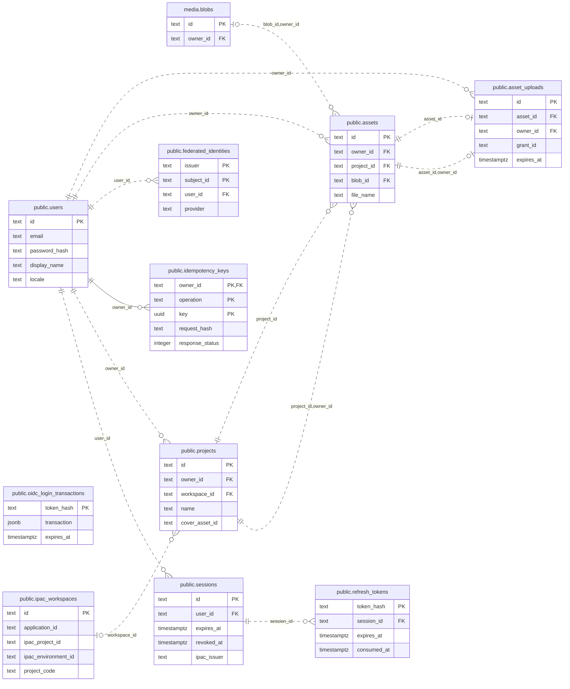

## 文件与上传：5张新增

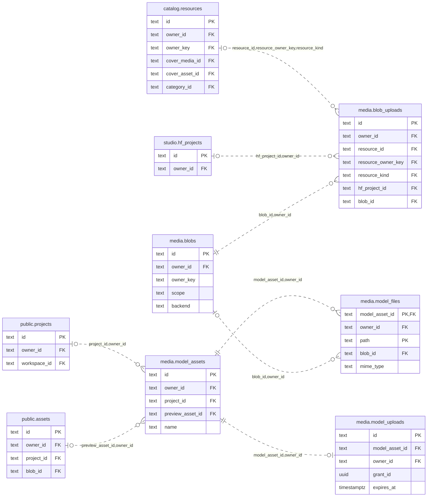

## 画布标签与引用：3张新增

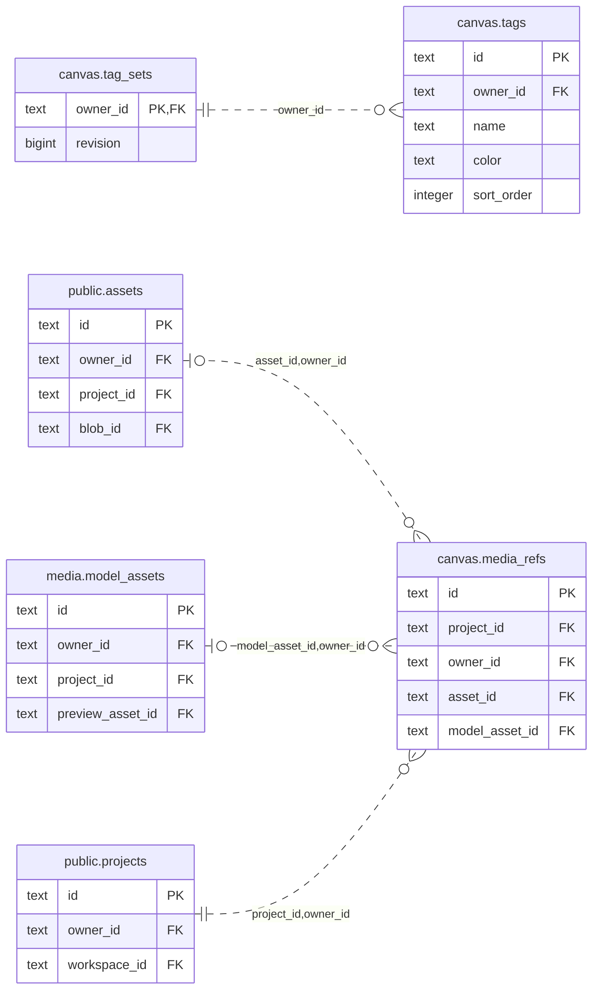

## 角色目录：7张新增

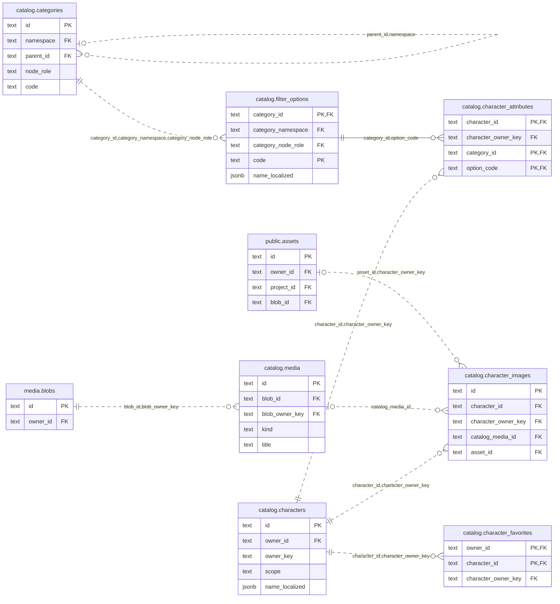

## 模型能力：5张新增

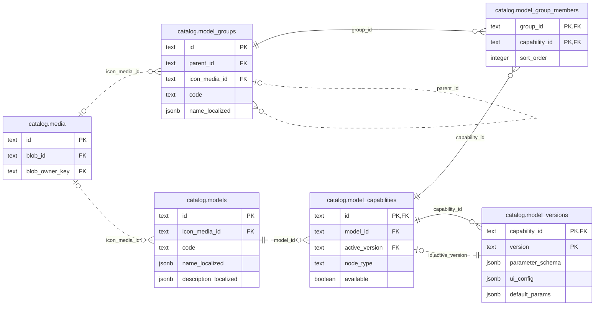

## 版本化内容目录：9张新增

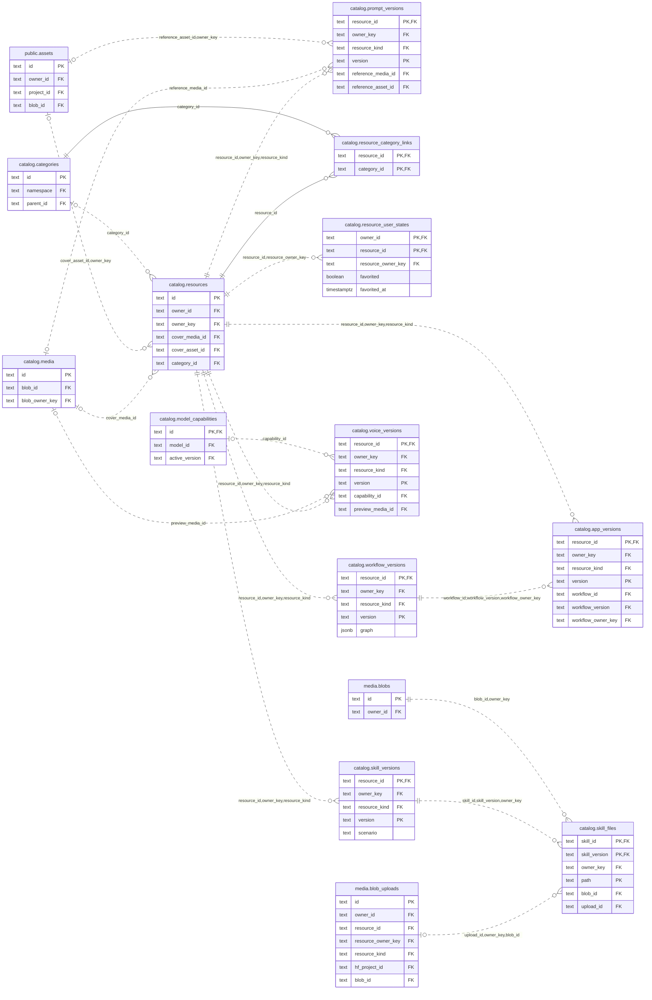

## 个人素材库：5张新增

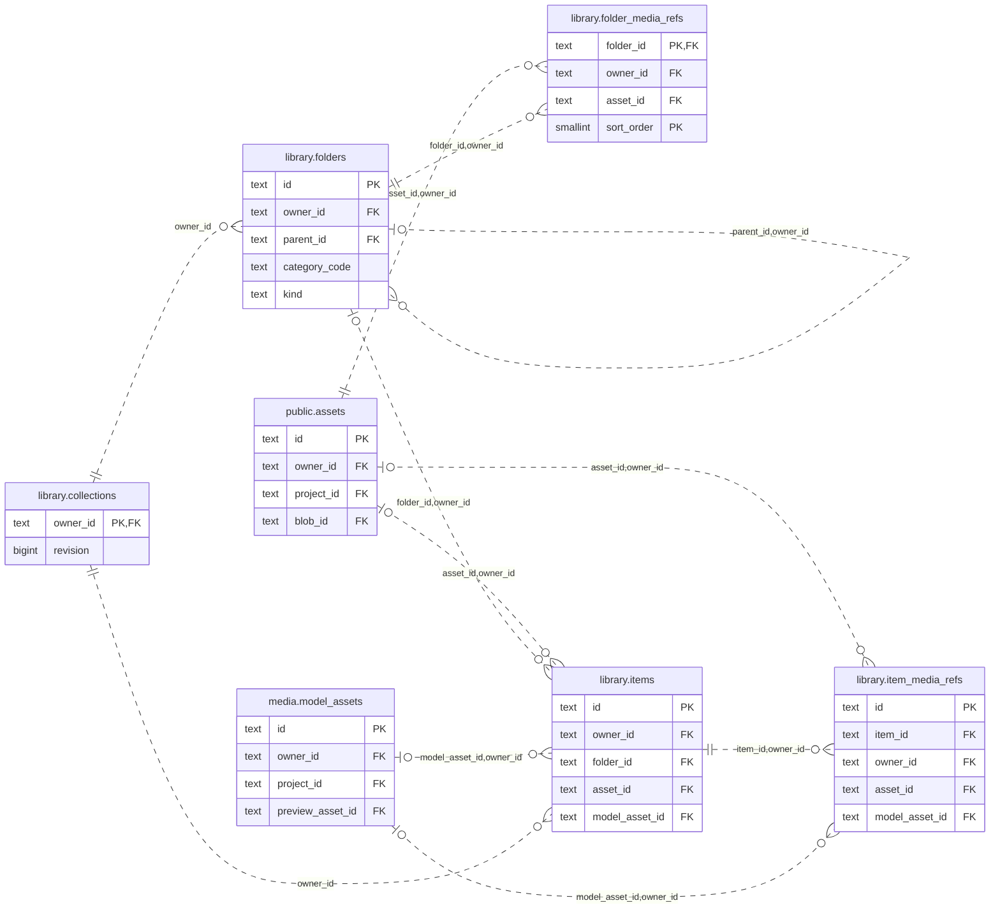

## 生成与历史：8张新增

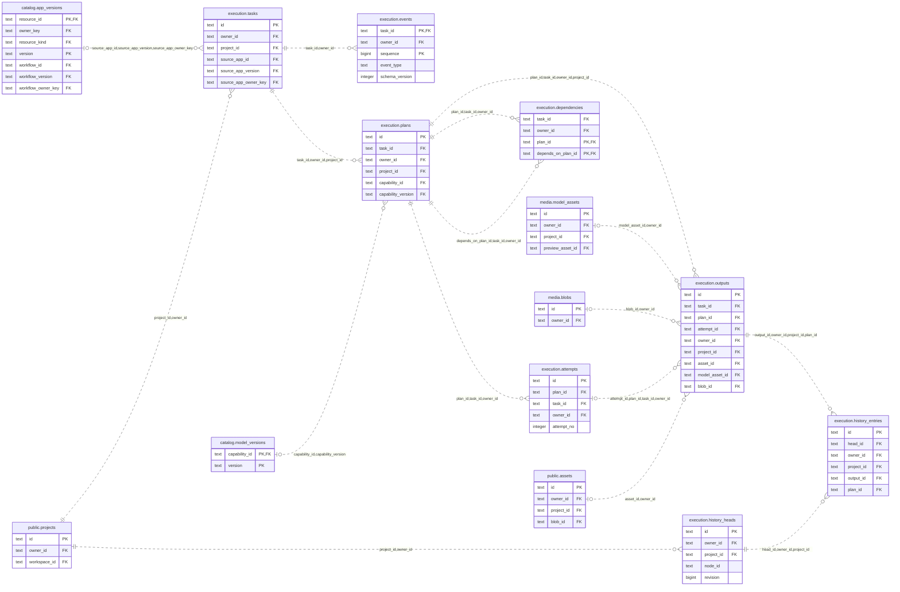

## Agent：5张新增

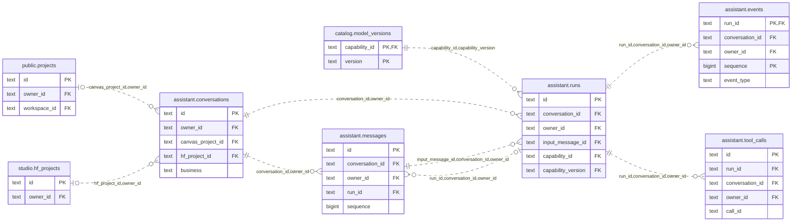

## HF与独立导演：8张新增

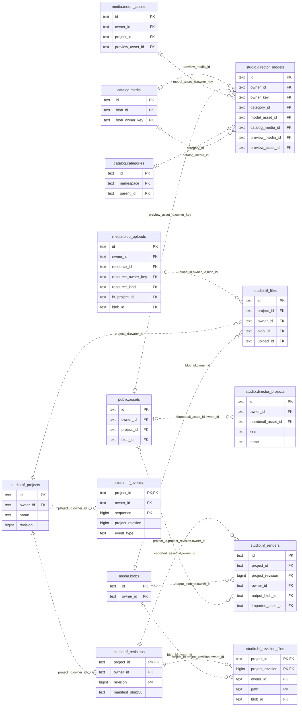

## 可靠投递：2张新增

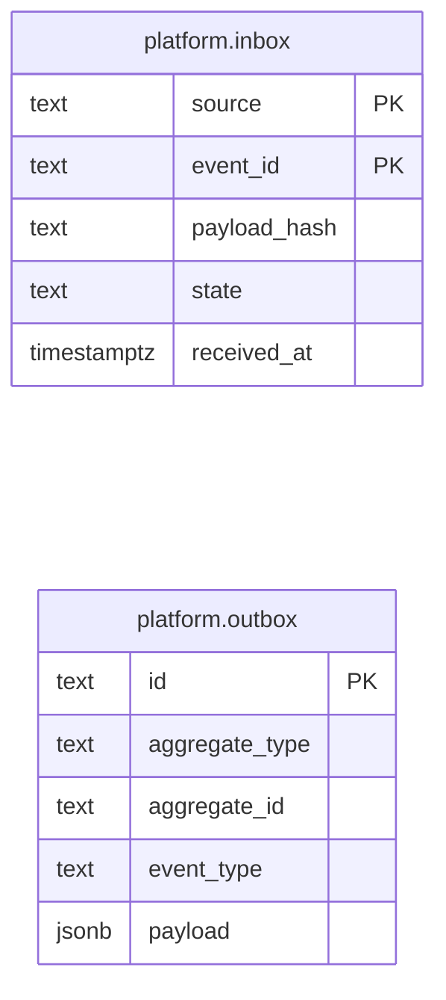
