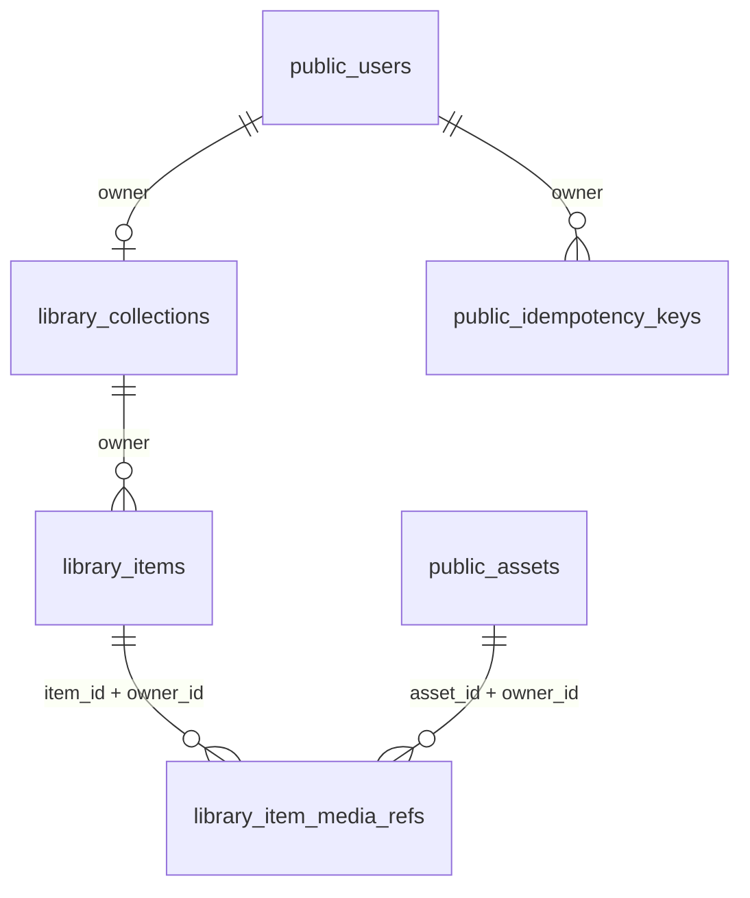

# Library 实际接口

本轮实现本人角色与场景图库的最小持久化切片。每个图库包含 title、description、kind=ROLE/SCENE、有序的本人图片 Asset ID、可选主图与 revision。它是 `library.items` 聚合，与公共角色目录分开；新账号返回真实空列表，不导入原站人物或场景为已注册作品。独立合同为 [library-extension.json](../contracts/library-extension.json) / [yaml](../contracts/library-extension.yaml)，冻结核心合同、旧 domain-extension 与 57 表规划保持原状。

| 方法与路径 | 状态 | 实际行为 |
|---|---|---|
| GET `/api/v2/library/items` | IMPLEMENTED | 本人有效 ROLE/SCENE 图库分页与 title/description 关键词搜索 |
| POST `/api/v2/library/items` | IMPLEMENTED | 同事务创建图库、媒体引用、库 revision 和 UUID 幂等回执 |
| GET `/api/v2/library/items/{id}` | IMPLEMENTED | 本人详情与当前强 ETag；重新校验媒体引用可见性 |
| PATCH `/api/v2/library/items/{id}` | IMPLEMENTED | If-Match 下完整替换可编辑字段，图库类型不可改变 |
| DELETE `/api/v2/library/items/{id}` | IMPLEMENTED | If-Match 下软删；历史媒体引用保留 |
| GET `/api/v2/library/state`、`/entries`、`/folders` | RESERVED | 已注册，501 |
| POST `/api/v2/library/folders`、PATCH `/folders/{id}` | RESERVED | 已注册，501 |
| POST `/api/v2/library/batch-create`、`/batch-delete`、`/move` | RESERVED | 已注册，501 |
| GET/POST `/api/v2/library/items/{id}/images` | RESERVED | 先验证图库归属，随后501 |
| PUT `/api/v2/library/items/{id}/images/order` | RESERVED | 先验证图库归属，随后501 |
| DELETE `/api/v2/library/items/{id}/images/{imageId}` | RESERVED | 先验证图库归属，随后501 |

未实现公共/共享/公司目录、分类筛选、收藏、文件夹、节点内容、其他媒体种类、独立图片增删排序或定价。上述之外的未知路径404。ROLE/SCENE 是本实施合同的图库类型；旧设计中 IMAGE/VIDEO 等是节点媒体种类，不混用，发送这些类型或旧设计字段时400。

所有路由使用真实本地登录和实时 `tv.access`；actor 只取 `httpapi.IdentityFrom(r).UserID`。请求正文中的 owner、IPAC 工作空间、任意 URL、节点 content 等未知字段均400。请求头中的 owner/workspace 不能改变数据归属。跨用户详情、更新、删除与图片子路径404；权限拒绝403，认证或授权依赖失效按现有中间件拒绝访问。

创建与完整替换正文：

```json
{
  "title": "我的角色",
  "description": "本人拍摄的参考图",
  "kind": "ROLE",
  "assetIds": ["ast_existing_owned_ready_image"],
  "mainAssetId": "ast_existing_owned_ready_image"
}
```

title 必须有非空白字符，最多120字符；description 必须为字符串，最多2000字符。assetIds 必须为数组，可为空，最多100个不重复 ID，顺序为展示顺序。mainAssetId 可省略或为 null，表示无主图；非 null 必须属于 assetIds。PATCH 接受与创建相同的完整投影，省略 mainAssetId 会清空主图。kind 在创建后不可变，owner、ID、创建时间与删除状态不可重绑定。

列表接受 page、size、keyword、kind；默认 page=1、size=20，最大 page=100000、size=100。关键词去首尾空白后最多300字符，匹配 title 或 description，SQL `%`、`_` 按文字处理。未知或重复查询参数400。固定排序 `updated_at DESC,id ASC`，同一个 SQL statement 取得总数与 ID 页，然后只聚合当页引用，避免多图导致重复条目或错误总数。返回 data 为 `{records,page,size,total,pages,hasNext}`；pages 为向上取整后的总页数，空库0页，页码超范围仍返回正确 total 和空 records。

图库 DTO 为 `{id,title,description,kind,itemType,revision,assetIds,mainAssetId,createdAt,updatedAt}`；ROLE 对应 ROLE_GALLERY，SCENE 对应 SCENE_GALLERY。没有 owner、storage_key、上游地址、凭据或虚拟图片 URL。创建/更新时，应用仓储确认每个引用满足本人 owner、`assets.kind='IMAGE'`、`assets.state='READY'`、`assets.deleted_at IS NULL`，并在事务内以 FOR SHARE 锁住资产，阻止并发软删绕过检查。详情、列表与幂等重放也通过应用仓储重新授权引用；后来不可用的引用在公开投影中隐藏，主图相应清空，数据库历史引用不被读取操作改写。列表批量授权当页全部 Asset ID，不逐图请求。

使用图片时先请求既有 `GET /api/v1/assets/{assetId}`；核心资产模块签发当前登录 session 的短期 previewUrl/downloadUrl，签名读取再验证本人归属和实时 `tv.access`。Library 不直接访问厂商地址，不新增绕过授权的 content 路由。

POST 必须带36字符带连字符 UUID `Idempotency-Key`，大小写归一。作用域为可信 owner+libraryCreateItem+key，规范请求哈希不受 JSON 字段顺序或字符转义影响；省略 mainAssetId 与显式 null 仍是不同请求。同 key/body 返回原始201投影与初始 ETag，不同 body409。重放检查当前图库可见性和有效媒体；根已软删404，既有回执不使作品复活。原始 revision 可以早于图库当前 revision，应 GET 详情取得当前版本后编辑。

PATCH 与 DELETE 必须带正整数强 ETag，例如 `If-Match: "2"`；缺少428，非法400，过期412并带 CURRENT_REVISION。成功写入递增 item revision、updated_at 与本人库 revision，DELETE 返回 `{accepted:true}` 和新 ETag。每次写入先锁 `library.collections` 本人根，再锁图库和需要引用的资产；图库数据、引用变更、revision 和回执都在真实 PostgreSQL 事务中提交，错误回滚。

迁移006只建立以下最小表与约束，不要求005存在。迁移器按文件名与 schema_migrations 执行，在空库依次运行已有迁移，在既有001–004库保留数据后追加006；已登记迁移再次启动不重复执行。



| 表 | 实际字段与约束 |
|---|---|
| library.collections | owner_id PK/FK users，revision>0、updated_at；本人写入串行根 |
| library.items | id PK，owner FK collections，title/description、kind ROLE/SCENE、revision、created_at/updated_at/deleted_at；unique(id,owner_id)；活跃 owner/kind/更新时间分页索引 |
| library.item_media_refs | PK(item_id,asset_id)，sort_order 0–99，unique(item_id,sort_order)，is_main；每图库最多一个主图；item与asset均使用复合owner FK；asset反向索引 |
| public.assets | 新增 unique(id,owner_id)，保留001中的 state/deleted_at 形态 |
| public.idempotency_keys | 复用核心 UUID 回执，不建立另一份请求账本 |

数据库触发器冻结图库身份与类型、要求更新 revision 增加、禁止软删后复活。READY 检查是应用事务中的实际跨表授权，不写无法维护的跨表 CHECK。资产删除检查仅看有效引用：

```sql
EXISTS (
  SELECT 1 FROM library.item_media_refs r
  JOIN library.items i ON i.id=r.item_id AND i.owner_id=r.owner_id
  WHERE r.asset_id=$1 AND r.owner_id=$2 AND i.deleted_at IS NULL
)
```

图库软删保留 refs，但不再阻止资产软删；复合 FK 不授权物理删除文件。根软删、资产软删和文件回收仍是不同动作。

主服务装配接缝：`postgres.New(*pgxpool.Pool) (*UnitOfWork,error)`，`application.New(application.UnitOfWork) (*Service,error)`，`http.RegisterRoutes(chi.Router,*application.Service,http.Protect) error`；Protect 签名为 `func(string,httpapi.Handler) http.HandlerFunc`，必须验证真实 session、实时能力并设置可信 identity。缺少 router/service/protect 拒绝注册。

验证覆盖领域状态与版本、应用事务失败回滚/UUID并发/归属/媒体批量授权、HTTP未知字段/参数/鉴权/RESERVED/合同响应。真实 PG 测试仅接受显式 TEST_DATABASE_URL，使用已有 testdb helper 创建和清理随机专属测试数据库，不接触传入数据库的用户表或默认 DATABASE_URL；未配置时明确 SKIP，不能称为真实 PG 验证通过。PG 测试包含空库迁移、001–004既有数据增量迁移/重复启动、并发回执、并发 revision、跨 owner复合 FK、持久化恢复与删除引用保留。
