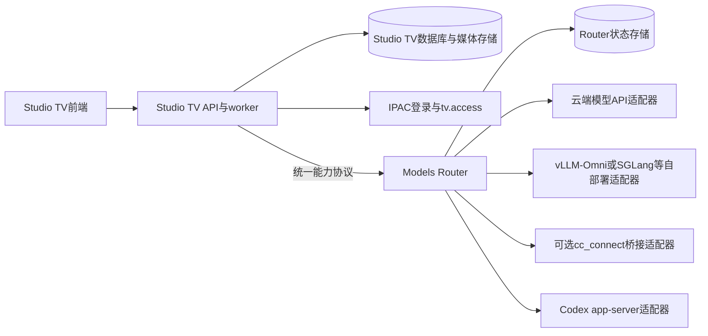

# Studio TV 与 Models Router 的边界

2026-10-05。本文保留总体设计。Router覆盖LLM、图像、视频、全能参考和Agent；vLLM-Omni、SGLang、自部署端点和模型厂商API分别由可替换适配器接入，Codex仅是Agent适配器之一。第1轮已实现独立Router逻辑会话/服务鉴权/防重放、STUDIO ModelGateway与GLOBAL/CANVAS会话持久化；实际协议见[Router合同](../contracts/models-router.yaml)和[会话合同](../contracts/assistant-extension.yaml)。Codex原生接入与执行账本尚未实现；[57表SQL](design/database.sql)和[ER蓝图](database-er.md)仍为全量规划，不可与004切片DDL叠加执行。

## 1. 会话与用户隔离

现有蓝图支持不同用户保存独立会话及历史：

| 产品数据 | 现有规划 | 归属检查 |
|---|---|---|
| 对话列表 | assistant.conversations | owner_id来自已验证登录；Canvas/HF根与同owner关联 |
| 对话消息 | assistant.messages | (conversation_id,owner_id)复合FK；会话sequence唯一 |
| 对话运行/工具/流 | assistant.runs/tool_calls/events | 同会话同owner；同会话最多一个活动LLM run |
| 画布生成及历史 | execution.tasks/plans/outputs/history_entries | 同owner、作品、任务/计划的复合FK；输出有真实媒体引用 |

上表是完整规划，runs/tool_calls/events尚未实施。当前assistant已实现会话和消息查询；新增ModelGateway开放Router能力目录与逻辑会话创建/恢复/查询，实际推理与事件仍预留。FK防止错绑，HTTP/查询/流/下载仍须逐次使用服务端可信actor校验owner；不能仅凭客户端传入的conversationId/sessionRef授权。公司目录共享不改变私人历史的归属。

区分四种ID：IPAC/本地登录session负责登录；STUDIO conversation负责产品历史；Router session负责逻辑续聊；Codex thread或厂商session是Router内部的原生状态。它们不能互作授权凭证。

## 2. 服务职责



| Studio TV负责 | Models Router负责 |
|---|---|
| 登录与工具权限；本人作品、画布、图库 | 上游凭据、端点、本地runtime、路由及配额调度 |
| 能力选择的产品展示、版本化参数表单 | 能力清单、参数/输入输出约束、运行可用性 |
| 产品对话、消息、生成记录、输出归档 | 原生session、上下文转换、推理调用和原生工具循环 |
| 画布DAG、版本冲突、业务工具及用户确认 | 原生回执核对、推理任务状态、流事件和取消适配 |
| 本人媒体读取授权、结果校验/导入、长期下载 | 临时推理输入/输出交换、统一artifactRef |

PF应用层定义ModelGateway port并通过它请求模型，领域层只管理产品不变量；外层HTTP适配器实现该port并调用Router。PF不import厂商SDK、读厂商密钥或解析Codex rollout。Router应用层也通过ports接厂商HTTP、本地服务、进程或bridge，外层适配器独立替换，领域层不依赖具体协议。

PF保留当前Go/chi作为HTTP transport；DDD与Router拆服务不要求先换Kratos。Router可独立发布、独立容器、独立数据库/凭据；双方不直接读写彼此业务表。即使使用同一PG实例，也使用独立数据库和账号。Router可在deployment-host运行，其他机器上的Codex/本地模型经受认证的runtime adapter接入，PF不需要直接SSH或依赖本机Codex进程。

## 3. 统一历史不等于统一原生上下文

PF历史是产品侧权威源。Router保留执行账本、原生session和可恢复的技术状态，不成为PF历史页面唯一数据来源。更换上游后，PF已有消息、图片、视频、生成参数和输出仍可查询。

| 场景 | 如何承载 |
|---|---|
| LLM聊天 | messages的TEXT/STRUCTURED；assistant.run承载本次回复与工具过程 |
| 对话里出图/生成视频 | assistant工具调用发起PF execution任务；完成后追加消息及ASSET输出引用 |
| 直接点击画布生成 | execution任务/节点历史，不强迫创建聊天会话 |
| 把既有图片用于图生视频 | 显式提交本人READY asset引用及参数快照；不依赖上游隐含记忆 |
| 多模态LLM输入 | Router按能力声明转换输入；不支持的输入明确拒绝或按事先约定的转换能力处理 |

现有MessagePart支持TEXT、ASSET、STRUCTURED，能够组织文字及图片/视频引用。聊天任务卡片拟新增后端创建的TASK_RESULT {taskId}，在messages.generation_task_id建立强FK，沿task→plans→outputs读取真实结果；不用无约束JSON里的outputId数组承担关系。生成任务限定同对话、owner及Canvas作品；附件也校验owner/READY，并纳入媒体保留/GC检查。

首期该生成关联用于CANVAS对话。现tasks.project_id和图片/视频Asset的project_id仍必填；独立HF对话的非Canvas生成，需要在P3一起明确task/asset来源归属，不能用HF工程ID冒充Canvas作品ID。Router能力协议本身不限定业务工程类型。

现有/history是画布生成历史DTO，要求真实task/plan/output，不可拿普通LLM消息伪造这些ID。对话展示用messages读模型，任务卡片投影同一份execution记录；若以后需要混合全局时间线，再定义CHAT/GENERATION判别DTO，不重复存两份输出。

多数图像/视频任务可以按独立调用管理。关联同一conversation意味着统一时间线，不意味着所有生成器都支持原生多轮记忆。切换LLM可重放经过授权的可见上下文；隐藏推理、原生工具状态、工作目录及缓存不保证跨实现迁移。产品历史连续与模型回答完全一致是两个不同承诺。

## 4. Router向上协议草案

仅PF服务端调用；协议版本独立于PF的/api/v1、/api/v2。逻辑会话与能力目录已实现；invocation、事件、取消、tool-results及artifact内容读取仍为RESERVED。以独立机器合同为准。

| 方法/路径 | 作用 | 主要参数/返回 |
|---|---|---|
| GET /v1/capabilities | 返回产品可用能力 | kind、分页；capabilityRef/version、parameterSchema、inputKinds/outputKinds、supportsSession、可选sessionMode、supportsStream/Cancel、available/reason |
| POST /v1/sessions | 创建逻辑续聊session | conversationRef；返回sessionRef，不返回native threadId |
| GET /v1/sessions/{ref} | 读取逻辑状态 | state/contextCheckpoint；不暴露其他用户session |
| POST /v1/invocations | 提交一次LLM/图像/视频等调用 | capability、输入、参数、sessionRef?、上下文；202 invocationRef/state |
| GET /v1/invocations/{ref} | 查询/恢复任务 | state、progress?、normalizedError?、outputParts、artifacts |
| GET /v1/invocations/{ref}/events | 可恢复SSE | Last-Event-ID；sequence/type/schemaVersion/data |
| POST /v1/invocations/{ref}/cancel | 请求停止 | 202；最终结果可能先完成，不能假报已取消 |
| POST /v1/invocations/{ref}/tool-results | 返回PF业务工具结果 | callRef、结果；同调用幂等，WAITING_TOOL时校验 |
| GET /v1/artifacts/{ref}/content | 读取推理输出 | 同actor授权、实际字节、校验摘要/类型/大小；PF导入自己的Asset/Blob |

capabilityRef是稳定能力句柄，如chat.general、image.generate、video.from-image；具体模型名可以作为可选能力项展示，但不泄露实现端点/密钥。图片/视频可以省略sessionRef或传null；sessionMode=NONE/OPTIONAL/REQUIRED声明会话要求。supportsStream表示原生增量输出，与任务事件SSE分别解释。参数不是一套覆盖所有模型的巨型固定结构：每个能力版本发布明确parameterSchema、输入输出类型和限制；PF保存只读版本投影及UI配置，Router再次校验。兼容适配尽量在Router完成；新增产品能力/不兼容schema时双方仍需升级，不能承诺任意协议变更都无需修改PF。

例：图生视频调用（示例值，非已注册能力）：

```json
{
  "schemaVersion": "1",
  "operationRef": "attempt_1",
  "capability": {"ref": "video.from-image", "version": "1"},
  "correlation": {"projectRef": "project_1", "conversationRef": "conversation_1"},
  "input": [
    {"type": "TEXT", "text": "镜头缓慢推进"},
    {"type": "MEDIA", "attachmentRef": "input_image_1"}
  ],
  "attachments": [
    {"ref": "input_image_1", "sourceRef": "asset_1", "kind": "IMAGE", "sourceVersion": "1", "sha256": "aaaaaaaaaaaaaaaaaaaaaaaaaaaaaaaaaaaaaaaaaaaaaaaaaaaaaaaaaaaaaaaa", "readGrantRef": "grant_1"}
  ],
  "parameters": {"durationSeconds": 5, "aspectRatio": "16:9"},
  "parameterSchemaVersion": "1"
}
```

readGrantRef由双方受控的媒体交换网关兑换短期读取授权；不把assetId直接当文件读取凭据。后续实现需补全交换合同和网关端点。输入身份包括稳定sourceRef、内容摘要/版本，短期grant轮换不改变业务请求哈希。输出artifactRef经服务端导入真实Asset/Blob后才成为PF可长期使用的历史；临时厂商URL不作永久结果地址。

统一运行状态：QUEUED/RUNNING/WAITING_TOOL/CANCEL_REQUESTED/SUCCEEDED/FAILED/CANCELED/UNKNOWN。UNKNOWN代表提交发生与否待核对；PF状态投影通过显式映射转换，不能直接写不在PF枚举中的值。assistant.run目前没有UNKNOWN，扩展前保持非终态并记录待核对原因，停止重复提交。

事件包括text.delta、tool.requested、artifact.ready、state.changed、progress.updated、runtime.metadata.updated；每次调用有持久且单调的sequence，完成结果有稳定outputRef。输入不支持、未配置、过载等返回明确HTTP错误和版本化错误码。进度不可得时为null；原生错误归Router日志，PF只保存标准错误/诊断引用。

## 5. 双方一致性与隔离

- PF验证IPAC身份、tv.access及对象owner，再以服务身份发送可信actor上下文；Router校验服务身份、actor声明并绑定clientApp+subjectRef。浏览器不能指定上游actor、任意sessionRef或供应商凭据。调用、session、artifact、事件流均校验这一作用域。
- 逻辑session按clientApp+subjectRef+conversationRef幂等创建；路由变更不改变PF conversation。前端只选择经过PF校验的对话，Router内部才解析原生绑定。
- PF先事务保存输入/任务/outbox，再由worker提交Router；Router先持久接受再返回202。恢复使用同一个Idempotency-Key及operationRef；同作用域同键同请求返回同invocationRef，不同请求409。STUDIO→Router和Router→上游各自负责去重。
- 稳定提交键使用assistant.run.id或execution.attempt.id。同attempt的网络重发与lease接管重用键和invocation；明确的新尝试才建新attempt/key，Router内部重试仍属同invocation。上游提交超时进入核对，不盲目换供应商或重复计费执行；UNKNOWN未核对前不能靠新attempt再次提交。
- PF复用platform.inbox：source=models-router:<routerKey>，event_id=<invocationRef>:<sequence>，核验payload_hash；inbox、任务/消息投影、产品events和消费游标同事务推进。PF在聚合锁内分配自己的events序号，不直接复用Router序号或无锁MAX+1。
- 同一最终结果可能在不同事件序号中重述，因此回复/文件导入还按稳定outputRef或run的确定性回复ID幂等。任务卡片在同会话同generation_task_id范围只创建一次；进度变更用事件投影，不重复追加结果消息。
- LLM每轮冻结实际规范化消息内容、ID/sequence、工具schema、Skill版本及内容、参数、模型能力版本、附件摘要和summary/checkpoint；不能只存消息ID后在重投时读取最新content。Router有原生session时只续接未消费输入，无原生状态时重新构造经授权上下文；不能将整个历史重复追加到正在续聊的thread。上下文压缩/筛选的策略与摘要版本必须可追溯。
- session按逻辑conversation串行续聊；不通过浏览器登录session定位原生thread。推理调用和产品任务有各自生命周期：Router成功但PF导入文件失败时，PF尚未完成可用结果，允许重试导入同artifact，不能再次推理。
- 模型提出的PF工具调用经固定工具名/schema和确认策略进入PF用例；Router只收到必要结果。Codex本地shell/文件工具由其runtime adapter管理，不获得PF数据库、IPAC凭据或未经授予的用户媒体。

## 6. Codex session接入

若选择Codex后端，其适配器包装app-server的stdio协议，暴露本文件的统一HTTP/SSE能力。官方提供thread/start、thread/read、thread/resume、thread/fork及turn/start和流事件；可读取已有历史、续接同thread或分叉后继续。实现时固定CLI版本并生成对应协议schema。WebSocket transport被官方标为实验性且不支持生产使用；不将它直接作为PF公共接口。[官方Codex App Server文档](https://learn.chatgpt.com/docs/app-server)


原生绑定必须包含runtime身份、存储命名空间、threadId、写入租约及已同步item/turn checkpoint；仅threadId不足以保证该session能在另一台机器恢复。绑定为Router私有状态，PF只持有logical sessionRef。

| 接入已有Codex会话的模式 | 语义 |
|---|---|
| IMPORT | 读取经授权的可见历史，规范化为PF消息；后续另建原生会话，不声称复用全部runtime状态 |
| FORK（建议） | 在可访问原session的runtime复制历史到新thread，交Router管理；避免PF与桌面两个写入者同时追加 |
| RESUME | 继续同一个原生thread；需已验证归属、可访问原存储/运行环境，并统一控制全部写入者及同步checkpoint |

导入是后续专用受控流程，不是让PF随意枚举本机所有Codex历史。IPAC用户与上游运行账号的关联须显式建立；不同PF用户的thread/文件区互相隔离，不使用--last定位用户会话。导入原生item按runtime+thread+itemId去重，只投影必要内容；路径、凭据和私有工具输出不直接展示。

cc_connect可作为Router中的可选bridge适配器。其具体部署和协议尚未核对；必须证明它能提供所需thread归属、历史读取、续聊、事件/工具映射和恢复能力，才能宣称支持对应模式。PF不依赖cc_connect的私有协议。

## 7. 对57表蓝图的最小调整建议

不为每种模型另建一套聊天表。下面是P2待合并字段/行为清单，当前SQL与DBML未增加这些列：

| 现有表/模块 | 拟调整 |
|---|---|
| assistant.conversations | nullable router_key/router_session_ref，成对为空；部分unique(router_key,router_session_ref)避免同一Router逻辑句柄绑定不同owner。增加unique(id,owner_id,canvas_project_id)供Canvas任务绑定。原生session及多路绑定只在Router存储 |
| assistant.runs | router_invocation_ref、router_event_sequence、request_hash及冻结context_snapshot；上下文快照不可变，lease接管重用提交键 |
| execution.tasks | 可选conversation_id；FK(conversation_id,owner_id,project_id)→conversations(id,owner_id,canvas_project_id)；增加unique(id,owner_id,conversation_id)供消息绑定。直接画布生成保持NULL |
| execution.attempts | 旧provider_key/provider_task_id只代表Router端点别名/invocationRef；实现时改为清晰命名并增加消费游标，不保存厂商原生taskId。task_id仍是PF自己的任务FK |
| catalog.models/model_versions | provider_key移出PF；executor binding只留Router能力引用及版本。厂商路由、账户、SDK配置放Router；PF保留产品目录/schema/UI的不可变投影 |
| assistant.messages及媒体引用用例 | nullable generation_task_id；FK(generation_task_id,owner_id,conversation_id)→tasks的同键；部分unique(conversation_id,generation_task_id)。后端创建TASK_RESULT卡片，客户端不可伪造；附件owner校验和GC引用扫描。引入多模态生成工具无需重复建messages表 |

session映射与Router调用表不计入PF的57张表。Router自己另行建最小session/invocation/receipt存储；双方无跨数据库FK。能力新增阶段的SQL、DBML及机器合同需要一起更新，不能仅凭本文就标记接入已完成。

首个实际验证切片：两个用户各自创建并恢复对话；Router的一个受控LLM适配器；文本流重连/取消/重复提交；真实输出导入。然后扩展文生图/图生视频及受控Codex会话复用。未配置适配器保持明确错误，不用模拟结果证明打通。
