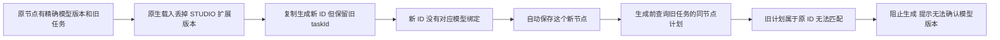

# Studio TV 与 RunningHub 节点生命周期和状态校验审计

本文记录修复前基线的审计结论。本轮修复规则、真实任务验收和发布状态见 [节点复制修复验收](node-copy-fix-validation-2026-11-05.md)。

Studio TV 当前确实存在可复现的节点状态不一致。核心问题发生在原生画布、STUDIO 模型版本绑定、当前表单、执行记录之间：它们各自保存部分状态，但复制、模型重选和参考素材变更没有统一的转换规则。严格的生成校验会拦住其中一部分错误，却无法替代正确的节点状态迁移。

本次对应生产 Web 镜像标注的源码提交 `59604de71837fb7d2c6d2c9047335d57e5a36032`，现用本地源码与之相同。服务器部署目录的 Git HEAD 较旧，不能拿它代表正在运行的网页。RunningHub 对照的是 2026-11-05 实际加载的 RHTV 无限画布客户端，不是 ComfyUI 节点系统。以下 RunningHub 结论只涉及可检查的客户端行为，不推断其私有后端实现。

**最重要的发现**

| 优先级 | 发现 | 使用者影响 | 证据强度 |
|---|---|---|---|
| P1 | 复制产生新节点 ID，旧任务编号仍在，STUDIO 模型版本却可能丢失 | 新节点保存后，查旧任务时找不到属于新 ID 的执行计划，出现“无法确认上次模型版本” | 使用实际原生序列化和复制函数、STUDIO 存储逻辑隔离复现了截图原文 |
| P1 | 整段复制没有重映射图片、视频、音频的排序键 | 首尾帧或多参考顺序可能从用户排序退回连线顺序 | 隔离复现两张图由 B、A 变成 A、B；当前 RunningHub 已有排序键重映射 |
| P1 | 连线校验读取原生节点，未先恢复 STUDIO 模型版本 | 连线按当前目录版本判断，生成按已保存历史版本判断，二者可能矛盾 | 原生数据与恢复绑定后的同一节点得到不同校验结果 |
| P2 | 同型号 API 视频模型重选不一定记录版本 | 提示用户“重新选择模型”，但再选同一项仍可能无法解除阻塞 | `apiVideoSelectionProps` 仅在型号与旧型号不同时补绑定；隔离复现 |
| P2 | 视频模型菜单的参考校验缓存只按数量区分 | 替换成合规素材后，数量不变，菜单仍沿用旧的禁用原因；反向也可能保留旧的允许状态 | 重复首尾帧替换为两张不同图片后，完整规则已允许而菜单仍禁用 |
| P2 | 文字和图片模型回调先登记绑定，再调用实际画布修改 | 原生修改被拒绝时，附加绑定已经改变，存在后续状态分歧风险 | 对返回 `false` 的修改回调隔离复现；不能据此断言现场每次都会触发 |

**节点需要区分的五种状态**

现在很多字段混在 `node.data` 中。产品上至少应分清：

| 状态维度 | 内容 | 不应混淆的事情 |
|---|---|---|
| 节点身份与配置 | 节点 ID、类型、提示词、模型型号、能力版本、参数版本、参数、参考关系 | 复制配置不能复制任务归属；更改结果选择不等于换模型 |
| 输入可生成性 | 正在检查、可生成、缺素材、不兼容、能力未接入、暂时查不到 | 未检查完成不能叫“可生成”；网络检查失败不等于用户素材错误 |
| 执行状态 | 未提交、提交中、受理未知、排队、运行、成功、失败、取消 | 节点显示 `idle` 不证明没有旧任务；请求超时不证明没提交 |
| 结果与历史 | 当前展示结果、选中的历史结果、任务来源、批次、结果资产 | 新副本可以保留结果作为参考，但不应声称自己拥有原任务 |
| 保存与编辑权 | 未确认操作、已提交状态、同步中、只读、节点占用 | 保存成功不等于输入有效；生成成功不保证还能写回被改动的节点 |

**STUDIO 各类节点的实际生命周期**

| 类型或行为家族 | 创建和编辑 | 运行及结果 | 主要合理性规则 |
|---|---|---|---|
| 文字 | 手输、粘贴、上游文字；可作为纯内容，也可配置生成 | 语言模型生成文字，写入结果和历史 | 文字生成与图片理解的输入类型要匹配；纯文本编辑不应改变已选模型 |
| 脚本、分镜 | 保存结构化内容、角色和镜头关系；部分子节点派生 | 单节点或专门分镜生成流程，可能创建多个图像或视频节点 | 区分结构化内容、生成目标和素材子节点；普通分组检查不能代替专门分镜流程 |
| 上传图片、视频、音频 | 文件接收、上传、资产就绪；可播放或作参考 | 素材节点本身不应再次跑生成；可连接到生成目标 | 上传中、失败、临时地址、资产不可访问必须拦截；不能仅凭有媒体就认定是上传素材 |
| 生成图片 | 选型、描述、参考、预设；参数和生成结果同存一个节点 | 成功显示图片并保留历史；指定批量模型可派生额外结果节点 | 生成所有者保留可编辑配置；批次其他结果是素材节点，不应混作生成所有者 |
| 图片工具 | 从原图进入增强、局部编辑、姿态、灯光等 | 有些在源图旁建结果节点；裁切旋转等属于本地操作；生成类走模型 | 工具节点和原图要明确区分；没有输出的失败工具节点仍应可修改重试；本地操作不应要求模型 |
| 生成视频 | 文生、首帧、尾帧、首尾帧、全能参考、动作迁移等模式 | 选择精确模型及参数，生成视频，选择历史可改变下游引用 | 模式、型号、版本、参考数量与角色必须同时一致；首尾帧顺序属于输入语义 |
| H3 分段长片 | 专用长片参数和作业状态 | 由专门长片流程管理分段及结果 | 通用生成按钮会避让长片控制；不能并行启动两套生成流程 |
| 视频处理 | 从源视频选择裁切、旋转、倍速、抽帧、提取音轨等 | 浏览器操作或媒体处理服务产生新结果 | 媒体处理结果重试要求返回源视频工具；提取音轨对输入和批量方式有单独限制 |
| 音频生成 | 原生界面存在生成/克隆/识别等概念 | 当前代码对多项音频生成、识别、分轨、对口型标记未接入；已有音频仍可使用 | 可见节点或菜单不代表已有可执行服务，必须按能力目录及入口状态展示 |
| 3D 模型、世界、导演台、画板 | 上传已有内容，编辑场景或绘制；也有生成入口 | 本地编辑/导出与 AI 生成分别处理；多项 3D 生成尚未接入 | 已有素材可用不代表对应生成模型可用；导演台手动布景与 AI 场景识别不是同一能力 |
| AI 应用 | 保留应用输入绑定、应用元数据 | 执行层有独立应用计划处理，但产品入口目前标记暂未开放 | 应用绑定、输入、输出需独立验证，不能视为普通图片生成 |
| 分组、评论、资源引用 | 组织、说明、引用，不拥有普通生成任务 | 分组可展开成员发起执行；评论和资源等排除在生成目标外 | 仅含素材的分组不能执行；分组复制需映射成员和内部引用 |

实际可用能力还取决于当前目录、账号权限和模型凭据，上表不能代替实时目录。代码入口主要是 `generation-readiness.ts`、`execution.ts` 的 `nativeKinds/kind/inspectGeneration`、`node-tool-contract.ts` 和 `canvas-tool-availability.ts`。

**从打开画布到再次生成的流程**

1. 读取服务端画布和权限，建立编辑会话；原生画布展示一份投影。当前同步方向以服务端已提交状态和未确认操作队列为主。
2. 原生序列化 `D1n/wct` 只保留已知字段。`modelCode`、`params`、`taskId` 可留下，STUDIO 的 `capabilityRef/capabilityVersion/parameterSchemaVersion` 不在原生白名单中。
3. STUDIO 的 `ModelBindings` 用项目 ID、节点 ID、节点类型和型号匹配，在展示、保存、生成的一部分入口补回精确版本。这能保护同 ID 节点，但不会自动推断一个新复制节点来源于谁。
4. 用户编辑模型、参数、参考、历史选择。部分表单值仍暂存在组件中，生成前会构造按钮对应的候选输入；候选不能擅自替换已保存的模型选择。
5. 连线悬停和提交前检查拓扑、已知参考上限及素材约束；未知的模型/历史/资产信息留给异步检查。
6. 生成预检查恢复版本、验证目标、解析资产与实际输入、匹配模型和参数。旧节点缺版本但有旧任务时，尝试从同一项目、同一节点的任务计划恢复；不能匹配则阻止生成。
7. 真正提交还要冻结输入，比较原生组装命令和当前画布，等待实际保存回执，再比较保存内容和执行输入，携带已确认版本提交任务。
8. 服务端绑定任务与目标节点、输入版本和输入摘要；前端维护自己的提交/运行身份，接收进度并刷新结果。
9. 结果返回时，服务端再次判断节点是否被删除、输入是否变化、任务是否已被替代、历史与资产是否仍有效。无法安全应用时记为 `DETACHED`，不强行覆盖当前画布。
10. 再次生成应基于当前配置和当前参考，建立新任务；历史结果保留为历史。删除节点、撤销、重新打开页面以及复制，都应有各自的身份规则。

这说明 STUDIO 并非没有校验。现在的问题是前面的状态转换不完整，使后面的防错检查经常承担“发现坏状态”的工作，用户只能看到阻塞提示。

**复制粘贴究竟改变什么**

以已经生成过的视频节点 A 复制为 B 为例，使用 STUDIO 实际原生函数得到：

| 内容 | 当前 STUDIO 复制行为 | 合理的目标行为 |
|---|---|---|
| 节点 ID | 重新生成 | 正确，B 是新身份 |
| 模型型号与普通参数 | 通常保留 | 保留型号、精确能力版本、参数版本作为一个整体 |
| STUDIO 模型版本 | 原生载入已丢失时不会随新 ID 自动迁移 | 从经过验证的源节点配置显式复制，禁止猜最新版本 |
| `taskId`、估时字段、旧错误 | 可保留 | 新副本清除执行身份、进度、估时和错误；来源另记 |
| 运行中状态 | `running/processing/uploading` 重置为 `idle` | 还应同时清除执行身份，不能只改状态词 |
| 完成、失败状态 | 上述重置函数没有统一重置它们 | 新副本以配置和结果来源重新判定状态 |
| 结果 | 保留当前选中结果，压缩为一份结果 | 可作为预览/参考保留，但明确来源于 A 的某次结果 |
| 历史所有权 | 清除历史存储与选择字段 | 不继承原节点历史所有权；需要历史时单独授权引用 |
| 分组成员和部分来源字段 | 映射到新节点 ID | 继续保留，同时覆盖所有语义引用 |
| 素材排序键 | 没有映射 `imageOrder/videoOrder/audioOrder` | 同步映射节点 ID、复合排序键和素材角色 |
| 跨画布外部边 | 找不到原端点时丢弃 | 可丢弃，但要立即显示缺输入并重检 |

还有一个容易误解的交互差异：**快捷键复制粘贴与菜单“复制节点”不是完全相同的连线策略。** 快捷键复制收集所有接触选中节点的边，同画布粘贴可保留外部入边，并向已有下游新增出边；菜单复制函数只收集入边。拖动复制的另一条路径不带边。STUDIO 和本次检查的 RunningHub 都存在这类区分，因此“我只是复制一个节点”可能已经改变原下游的输入数量。

已经隔离复现的失败链是：

在副本尚未进入已保存快照的阶段，历史恢复条件又可能不成立，无版本选择会走当前目录解析。于是同一副本在保存前后可能走不同分支；不能靠“删掉旧 taskId”单独修复，否则可能把阻塞改成悄悄使用最新模型。

**三张截图分别说明什么**

用户随后确认，现场触发操作是“复制一个带有连线、已有生成结果的视频生成节点”。针对这一条件补做隔离复现：成功视频的副本保留 `finished` 状态、视频结果、原模型型号、旧任务编号和指向副本的入边；精确模型版本缺失，历史存储及历史选择被清除。该副本保存后，模型恢复同样报出第一张截图原文。因而第一项应优先按“已完成视频节点的复制迁移不完整”修复，而非要求用户反复重选模型。具体模型、参考数量和快捷键/菜单复制入口仍未提供，第二、第三项不能仅凭共同触发场景认定为同一根因。

| 截图 | 已确认的触发位置 | 当前判断 |
|---|---|---|
| 无法确认上次模型版本 | `storage.ts` 的 `historicalGenerationModel` | 已按用户确认的“带连线且有结果的视频复制”条件复现同一错误；现场具体任务仍未读取，优先定位复制迁移缺陷 |
| 最多 1 项图片，当前 3 项 | `connection-readiness.ts` 的 `readinessModelInputReason` | 指的是目标节点解析到的参考，不是画布总图片数。包括连线素材、行内提及素材、风格参考；不同来源节点指向同一资产仍可分别计数。复制带来的新下游边也可能增加数量。是否误判必须核对具体型号、版本和这 3 项来源 |
| 此功能的服务接口尚未接入 | `runtime.ts` 最后的未处理请求兜底 | 某原生动作没有匹配到已实现适配器；不是模型版本错误的别名。单张截图缺少操作入口和请求路径，不能确定是哪项功能 |

第二张截图中两处相同提示，也能由现有提示设计解释：连线提示和统一通知可以同时展示同一原因。它们不证明发生了两次生成失败。更合理的提示应明确“当前节点、实际模型版本、3 个参考来源”，并只保留一个主要说明位置。

**RunningHub 当前如何管理**

当前公开客户端仍有原生节点管理器、Yjs/操作队列、节点配置、任务与历史等不同层。并没有证据证明它把全部状态压成一个绝对统一的状态机，也不能假设它所有复制问题都已解决。

与 STUDIO 冻结的较早原生资源相比，这次看到的具体差异包括：

- 复制前获取完整节点，按类型处理当前结果、历史选择和可复制字段；不是简单复制屏幕上的卡片 DOM。
- 粘贴时重新生成节点 ID，映射边、组成员、来源字段；当前版本额外重映射图片、视频和音频排序键。
- 云软件节点的复制会清除任务、会话、租约和连接等运行字段；部分互动脚本运行状态也有专门清理。普通媒体的旧任务字段仍不能笼统说成全部清空。
- 当前提示词可能使用独立存储引用。跨画布复制会读取源提示词正文、为新画布和节点建立新引用，并检查账号和画布会话没有切换；不能仅复制原引用。
- 普通节点执行之外，Agent 的受跟踪执行有 `not_started → preparing → submitting → accepted/rejected/unknown` 协议、输入摘要、所有者及执行 epoch、续租和持久化回执。提交结果未知时先核对，不盲目重做。此观察限于该 Agent 执行入口。
- 历史选择、当前结果与参数快照分别处理。复制通常取当前选中结果，而不是把所有历史一并声明成新节点的历史。

这些可以借鉴为明确的转换契约；STUDIO 已有自己的服务端版本、权限、资产和任务绑定，不应照搬 RunningHub 的私有接口。

**现有合理性校验覆盖和缺口**

| 时机 | 已有校验 | 尚需统一的部分 |
|---|---|---|
| 创建与复制 | 新 ID、部分边及分组引用重映射、部分瞬态字段清理 | 精确模型绑定、全部执行字段、排序键、输出来源没有作为原子事务处理 |
| 模型菜单 | 按能力、输入类型、可用状态投影；部分历史版本显示保护 | 不同节点类型使用不同补丁；相同型号重选语义不一致；菜单缓存遗漏资产身份 |
| 连线 | 端点、自连、重复边、循环、端口、已知媒体类型与数量、部分文件约束 | 入口读取未恢复版本的原生图；缺版本时可能拿当前目录当规则 |
| 上传与引用 | 资产就绪、权限、临时 URL、真实 MIME、大小、时长、尺寸及选中历史 | 多入口应输出同一份“当前有效参考列表”，避免用户难以解释计数 |
| 异步预检查 | 目标资格、历史精确版本、输入/输出类型、最小最大参考数、视频角色、参数及提示词 | 对不能确认状态的原因应区分系统暂时失败、历史不可恢复、用户输入错误 |
| 真正提交 | 再次检查、冻结、保存回执比较、权限、运行占用、请求身份 | 校验规则大量依赖原生字段遗漏的特例补偿；新增模型或入口容易遗漏 |
| 运行与回写 | 当前任务身份、版本、节点存在、输入摘要、资产历史有效性、过期回写分离 | 保持这些保护；不要为了让副本跑起来而绕过它们 |
| 同步与恢复 | 已确认快照、操作队列、编辑会话、重连和页面恢复 | 同步只保证“这次改动被记录”，不能自动证明节点业务状态合理 |

**建议的整改顺序**

1. 先定义所有节点共享的复制契约。精确复制配置，重建身份，清除执行，保留带来源的选中结果，映射所有引用；在同一操作批次内提交节点、边、模型绑定。复制完成立即做不创建任务的预检查。
2. 将模型选择变成统一命令，处理“换型号”“同型号重确认”“显式升级版本”三种意图。原生修改成功后再提交绑定；失败时两边都不变。模型不可用只影响可运行性，不自动替换用户选择。
3. 连线、模型菜单、按钮预检查、提交共用同一份规范化节点视图、精确能力版本和参考解析结果。未知版本显示“待确认”，不能静默使用当前版本来宣判历史节点不合法。
4. 修正复制排序和参考缓存。缓存键包含素材身份、来源节点、历史选择、角色、顺序、必要资产元数据及模型版本，不只比较数量。
5. 按能力标识管理所有入口。工具菜单、快捷键、历史重试、悬浮面板都指向相同的可用性规则；未接入功能在动作前说明原因，避免最终只显示笼统兜底。
6. 为旧数据提供有边界的恢复：能由同一节点的可靠任务证明就恢复；明确知道复制来源时迁移配置；否则请求用户重新确认具体模型。禁止从型号名字或旧任务编号猜版本。

第一批修复应同时做“复制身份、模型版本、参考顺序”。只放宽生成前校验会掩盖问题；只删旧任务则可能改变模型版本和实际生成输入。

**应覆盖的回归场景**

| 场景 | 预期 |
|---|---|
| 从空白新建各类节点 | 身份合法，缺输入可解释，未接入不伪装可运行 |
| 复制空白、成功、失败、运行中节点 | 新身份保留配置，不继承活动任务、进度和旧错误 |
| 复制后立即生成、保存后生成、刷新后生成 | 三者模型版本、参数、参考一致 |
| 同画布单节点粘贴 | 明确入边及出边策略，原下游参考数量变化可解释 |
| 跨画布粘贴 | 资产和正文按目标权限确认，失效外部引用明确标记 |
| 复制整组首尾帧或多参考流程 | 每个排序键和角色映射到新节点，用户顺序不变 |
| 同一资产从不同入口重复加入 | 菜单、悬停、提交采用同一计数规则并列出来源 |
| 首尾帧数量相同但替换素材 | 立即更新可用性，不复用旧错误 |
| 重选同一模型、换模型、显式升级 | 都有明确意图和一致版本绑定；参数不兼容可定位 |
| 模型修改被拒绝或会话切换 | 原生状态和绑定都不变化，迟到回调不污染新画布 |
| 选择旧结果、换回当前结果 | 展示和下游使用同一结果，当前编辑配置不被暗中改写 |
| 生成时修改输入、删除节点、旧结果晚到 | 不覆盖新状态，任务结果仍可追溯 |
| 撤销删除、撤销复制、重做 | 恢复的是相应节点配置/来源，不复活旧运行中的任务 |
| 刷新、断网、多页面同步 | 未确认操作不丢失，恢复后重检生成条件 |

**证据与验证边界**

隔离复现使用合成节点和实际生产对应代码，没有创建生成任务、消耗模型额度、修改生产画布或发布改动。现有模型绑定、历史恢复、连线和粘贴占用回归检查通过；它们没有覆盖本次新复现的组合路径。STUDIO 浏览器会话显示当前账号无工作台权限，因此没有完成该账号内的真实画布端到端复现。用户已确认复制带连线且有结果的视频节点，补充复现覆盖了这一状态；具体节点、型号、参考来源和第三张截图实际请求仍未读取。

- [隔离复现结果](/home/developer/.codex/.chatgpt-projects/g-p-6ac0e1f123488191b3cc6e1888c8f289/outputs/node-lifecycle-audit-20261105/reproduction-results.json)
- [模型绑定实现](/home/developer/.codex/workspaces/studiotv-cicd-20261028/studio-tv/apps/web/src/service/model-bindings.ts:14)
- [旧任务模型恢复和截图错误来源](/home/developer/.codex/workspaces/studiotv-cicd-20261028/studio-tv/apps/web/src/service/storage.ts:856)
- [统一检查入口及连线守卫](/home/developer/.codex/workspaces/studiotv-cicd-20261028/studio-tv/apps/web/src/service/native-generation-readiness.ts:174)
- [模型菜单和选择回调](/home/developer/.codex/workspaces/studiotv-cicd-20261028/studio-tv/apps/web/src/service/model-selectors.ts:49)
- [视频参考缓存](/home/developer/.codex/workspaces/studiotv-cicd-20261028/studio-tv/apps/web/src/service/video-model-input-availability.ts:8)
- [服务端结果写回保护](/home/developer/.codex/workspaces/studiotv-cicd-20261028/studio-tv/apps/api-go/internal/modules/execution/adapters/postgres/node_writeback.go:218)
- [本次实际加载的 RunningHub 主客户端](https://rhtv.runninghub.ai/project/assets/appBootstrap-DUKMbHgg.js)：复制 `PAe/ise/DZn/AAe`、提示词迁移 `TL`、菜单复制 `D2t`。
- [本次实际加载的 RunningHub 画布客户端](https://rhtv.runninghub.ai/project/assets/CanvasEditorShell-B_tI5na7.js)
- [RunningHub 受跟踪节点执行模块](https://rhtv.runninghub.ai/project/assets/nodeRunExecution-D6-JtUqf.js)：该入口的提交阶段、身份与回执保护。

原生资源只在独立审计输出目录格式化阅读，未修改仓库冻结资源。本报告是问题梳理和整改设计，不代表这些问题已经修复。
