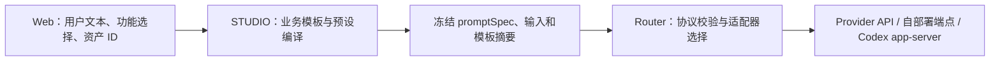

# Studio TV 提示词链路核对与 Router 首批能力

2026-10-06。基线：STUDIO `83a2010`、Router `07bf2fd`。功能坐标及原站证据见 [模型功能矩阵](model-function-matrix.md)。本文的“传输合格”指数据完整、可信来源清楚且能持久化重放；不代表真实模型已接通，也不代表 Mock 实现了模型语义。

## 接口核对

| 接口或入口 | 改造前结论 | 本轮改造要求 |
|---|---|---|
| `GET /api/v2/model-capabilities`、Router capability 目录 | 合格：能力、版本、参数 schema、明确 TEST MODE；STUDIO 后端执行需要读取全部分页 | 维持中立目录，不把原站 modelCode 当成真实适配器 |
| `POST /api/v2/canvas-runs` → Router `/v1/invocations` | 部分合格：owner、依赖图、素材授权、幂等和任务持久化已有；节点 `params.prompt`、场景、预设、参考用途等未完整编译 | STUDIO 服务端选择版本化模板，冻结 `promptSpec`；保留用户参数及媒体条件 |
| `POST /api/v2/app-runs` | 部分合格：表单来自服务端版本；缺少可信指令封套 | 采用同一提示词封套；任意 APP 的工作流执行器仍须独立配置，不能用通用图像 Mock 代替工作流 |
| 首页/画布对话 `conversation-runs`、HF 助手 | 部分合格：用户历史及归属持久化；缺少服务端指令、有角色的模型消息和 HF 输出要求 | 服务端依据真实 conversation business 选择模板，历史保持 USER/ASSISTANT 顺序；系统指令不接受浏览器提交 |
| 原生 `/canvas/prompt/enhance` | 不合格：英文产品指令由浏览器拼入用户文本，条件用途未规范化 | Web 只提交用户 prompt 和 `prompt.enhance` 选择；指令由 STUDIO 服务端维护 |
| 原生 `/canvas/invoke/api/llm`、技能文件优化 | 不合格：消息扁平拼接，角色和图文归属丢失 | 保留消息顺序和资产 ID；原生浏览器 SYSTEM/DEVELOPER 文本只能作为用户内容，可信角色由 STUDIO 模板生成 |
| 原生 `/canvas/sketchboard/realtime/generate` | 不合格：styleCode、live/manual 和草图用途丢失 | 提交 `sketchboard.generate`、条件和 SKETCH 引用；低延迟实时生成仍需真实能力适配器验证 |
| 原生语义抠图 `/openapi/v2/rhart-image/qwen-vl/prompt-matte` | 部分合格：素材归属已有；用途不明确 | 提交 `image.cutout` 及 REFERENCE_IMAGE；透明图、mask 和图层输出须由真实适配器保证 |
| 图像/视频/音频孤立工具调用 | 不合格：引用全部塞进 imageUrls | 按实际资产类型保存 image/video/audio 引用；首尾帧、蒙版、姿态和动作另用 conditioning 表达 |
| Router session、invocation、事件、产物读取 | 归属与持久化合格；现有 Mock 没有真正多轮推理或上下文恢复 | 保留 actor 隔离。真实适配器另外实现会话恢复、流式事件和用量，不将 Mock 历史当成模型记忆 |

## 提示词放在哪里

Web 的 `node.data.promptSelection` 只表达 `featureCode/sceneCode/presetSelections/promptCodes/conditions/referenceBindings/messages`，不提供可信 system 指令。STUDIO 模板有独立版本及 SHA256，执行记录冻结最终指令，后续修改模板不会改变旧任务。原站隐藏 preset 的原文目前未知；有公开功能语义的 STUDIO 模板属于自有替代，不能标成原站原文。

Router `promptSpec` 是可选、独立的 `schemaVersion: "1"` 封套：

| 字段 | 作用 |
|---|---|
| `templateRef/templateVersion/templateSHA256` | 来源与重放审计，Router 不解释 STUDIO 的业务场景 |
| `instructions[{role,text}]` | SYSTEM/DEVELOPER 文本，由可信调用方编译 |
| `messages[{role,inputIndexes}]` | USER/ASSISTANT 消息，关联同一请求的 typed input |
| `conditioning[{attachmentRef,role,targetAttachmentRef?}]` | REFERENCE_IMAGE、SKETCH、MASK、FIRST_FRAME、LAST_FRAME、POSE、DEPTH、MOTION_REFERENCE、SOURCE_VIDEO、REFERENCE_AUDIO、VOICE、STYLE |
| `outputContract` | TEXT/MEDIA/JSON_SCHEMA 输出要求；严格执行须有支持该约束的适配器与结果验证 |

封套连同模板摘要、条件和角色进入幂等请求摘要。附件仍需要 owner 对应的读授权。浏览器不能指定供应商密钥、模型服务 URL、本地路径或 Codex thread ID。

“系统提示词”是统一协议的指令层，不要求每个供应商都有同名 system 字段。LLM 适配器可映射到系统/开发者指令；图像适配器可能合成为最终 prompt；视频、相机、蒙版等还需要专门字段或模型输入。无法满足要求时应报告不支持，不能悄悄丢字段。

## Router 首批开放能力建议

| 产品坐标 | 首批能力 | 适配方案与限制 |
|---|---|---|
| 文本节点、首页/画布聊天、剧本、分镜规划、提示词优化、歌词 | 普通文本 LLM + 流式/多轮 + JSON 输出 | 直接供应商 API 或经验证的自部署端点。剧本差异主要由 STUDIO 模板、参考内容和输出 schema 表达 |
| 图片解析、反推提示词、风格提取、区域识别、导演理解 | 看图 LLM / 结构化识别 | 验证图片输入、bbox/实体 schema；视频理解需要原生视频输入或另行定义抽帧管线 |
| 角色/场景/分镜生成、三视图、公开分镜预设 | 文生图、多参考图生图 | 独立图像适配器，确认多图一致性、数量、比例和分辨率；提示编排不能替代所需视觉能力 |
| 草图、局部重绘/擦除/扩图、抠图、编辑元素 | 草图/蒙版编辑、语义抠图/图层 | 分开验证条件输入和输出；多阶段编辑由 STUDIO 编排各能力 |
| 视频节点、分镜视频、全能参考、动作迁移 | 文生视频、图生视频、首尾帧、图片/视频/音频参考 | 异步 job、查询/事件、取消、持久产物；各参考模式单独宣告可用性 |
| 画布 Agent、技能、HF 工程生成 | 有工具和持久会话的 Agent | Codex app-server 是候选；允许的工具、文件工作区、会话恢复和产物类型由 profile 约束 |

用户补充希望优先复用 ChatGPT 订阅，并租算力部署 MiniMax H3 Base。普通文本能力不必因此走付费 API：可由 Codex app-server 或经验证的订阅 HTTP 网关提供。Adapter 仍按文本、Agent、图像、视频分别声明能力；底层可以换为供应商 API、vLLM-Omni/SGLang 部署或其他端点。具体取舍和源码证据见 [订阅与 H3 选型](router-first-adapters.md)。

## Codex 封装边界

已核对本机 Codex CLI `0.159.2` 生成的协议 schema：`thread/start`/`thread/resume` 有 `baseInstructions`、`developerInstructions`；`turn/start` 有 `outputSchema`；token 用量事件有 last/total 和可空的 modelContextWindow。采用 app-server JSON-RPC 接口比解析 CLI 终端文字更适合提供稳定服务。持久 thread、turn、流式事件和当前轮输出 schema 见 [官方协议](https://learn.chatgpt.com/docs/app-server)。

Router 保存 `(clientApp, subjectRef, conversationRef) → sessionRef → 私有 runtime namespace/threadId`。一轮请求另有 invocationRef 和私有 turnId；重新登录不能创建新身份或丢失旧对话。STUDIO 保存产品消息，Router 保存运行时映射；模型累计消耗不能当作当前上下文占用。使用量未报告、剩余上下文无法准确测量时返回 null 或有来源的估算。详见 [既有 Codex 适配器设计](codex-router-infra.md)。

Codex 有原生图片生成/编辑工具；本机协议 `modelProvider/capabilities/read` 也包含 `imageGeneration` 布尔字段。具体 provider 和账号能否调用需要验证，不能只因模型选择器存在就标成可用。[官方工具实现](https://github.com/openai/codex/blob/402f5b6fdf28a7a72c153dbe6fe01e252205d7d6/codex-rs/ext/image-generation/src/tool.rs) Sign in with ChatGPT 的公开 API 路线目前单独限制 image-generation 等工具和音视频端点；这不是整个 Codex 产品的能力列表。[该认证路线的官方限制](https://developers.openai.com/siwc/token-sharing-open-source/preview-limitations) 直接图像 API 则有生成/编辑及图像参数。[官方图像工具](https://developers.openai.com/api/docs/guides/tools-image-generation)

已选公司管理的订阅账号，认证由 Router 运维配置，STUDIO 用户身份仍来自 IPAC。订阅账号、每用户运行目录和私有 thread 映射分开管理；不读取当前电脑的个人 Codex 登录目录。当前没有 sub2api 实例，因此先准备直接 Codex adapter 的离线协议验证。STUDIO 内部版继续屏蔽充值、收费和社区入口。

## 本轮验证结果

已完成上表的提示词传输改造：Web 提交功能选择和用户内容；STUDIO 服务端选择、冻结并持久化模板；Router 校验、保存完整封套。包含20类默认用途、3类服务端会话用途和45个公开分镜大师叶功能的PF自有模板。当前输入优先于旧展示结果；负向条件、多轮角色、图像/视频/音频引用和明确的首尾帧用途保留。模板要求一并冻结，worker恢复不重新选择新版模板。没有新增业务表，使用既有私有请求和JSONB持久化。

仍未完成的边界：
- 非测试能力继续返回 `MODEL_EXECUTION_DISABLED`，配置Router地址和密钥不能启用真实推理。
- 162个人物隐藏预设正文未知，返回 `PROMPT_TEMPLATE_NOT_CONFIGURED`；导演完整原生输出协议也未注册。
- 分镜 `shots` 仅有PF自有最小schema，原生完整分镜表和导演布局解析仍需专门适配。
- 生成产物作为特殊参考时，需要能证明用途的连线槽位；无法映射的组合明确失败。传输了camera/mask/pose参数不代表真实模型已经应用这些控制。
- 孤立工具目前只接已上传的图像、视频和音频；普通文件输入及未知消息部分明确报告未支持。
- 结构化功能的通用Mock文本会被 `PROMPT_OUTPUT_INVALID` 拒绝；20个既有Mock profile不改变，也不伪造符合业务schema的生成效果。
- 旧版未完成的画布/会话模型任务若缺少冻结封套，会明确失败，需要重新提交；不会重编旧任务指令或改写已完成历史。

2026-10-06最终隔离联合验收：STUDIO 416项、Router 131项Go测试及子用例通过，0失败、0跳过；包含真实PostgreSQL、race检查和实际签名HTTP客户端，未访问生产数据库。提交/查询/恢复时receipt若不再是testMode，会保留私有调用关联、明确失败并尝试取消，不发布业务结果或另发生成。Web 381项测试、类型检查、构建、49项合同检查和1198个原生资源基线校验通过。

复验命令：`python3 scripts/test-iteration-01.py --run --source-stable`。本机证据目录：`.local/iteration-01/20261006T012143-0b34524c8d7a/`；临时容器、网络与目录清理通过。提示词切片已部署deployment-host：STUDIO `3530208`（`studio-internal-v0.5.6`）、Router `67d54cb`（`v0.3.0-prompt-envelope`）。LAN入口仍为 `http://192.0.2.10:18880/projects/`，健康检查正常，未登录接口401。真实模型保持关闭，未产生模型调用。

独立的Codex离线包已提交Router `ba9697f`（`v0.3.1-offline-codex`），39项race测试及子用例、vet通过，0失败/跳过；不计入上面的联合测试数字。它未装配或部署，不新增可用模型目录。生产PrivateStore、公司认证/runtime、完整JSONSchemaValidator、OS工具隔离与事务事件outbox仍需接入。原生last/total分别保留，不将其猜成当前轮总消耗、剩余上下文或价格。
